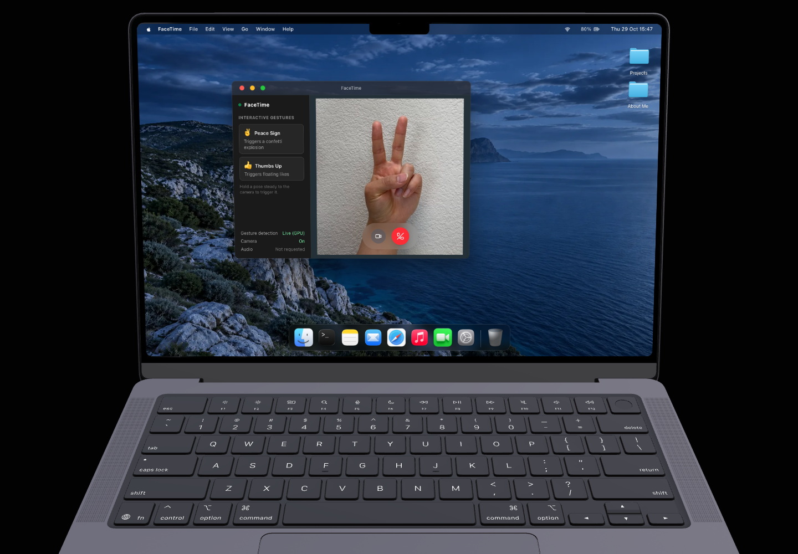
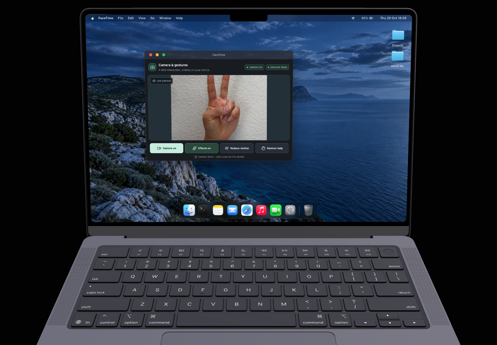

# Stage 8 — Camera interface and responsiveness

The camera's visual styling was subsequently revised to neutral macOS light/dark surfaces, plain status text and gray controls. See the [current appearance and verification](refinement/README.md). The original screenshots and profiling evidence below are retained as historical Stage 8 measurements; the camera runtime and scheduler are unchanged by the visual revision.

Stage 8 changes the camera app's presentation and frame scheduling. Stage 7's camera-only permissions, retry handling, exclusive detector ownership, GPU-to-CPU recovery, mirroring, gesture classification and close/minimize/visibility cleanup remain in place. No other app was redesigned.

## Before and after

Both captures use a **1440 × 1000 browser viewport**, the same portfolio camera position and the same **640 × 440 virtual app window**. The hand is a clearly identified test photograph, not a live webcam capture.

| Before | After |
| --- | --- |
|  |  |

[Normal after view](after-normal.png) · [320 × 380 window](after-narrow.png) · [Gesture help](after-help.png)

- Live preview is central. The existing window title bar remains the only window chrome.
- Camera state and gesture-model state have separate indicators. Starting, live, off, paused, loading, ready, recovering and failed states are distinct.
- Camera, effects, reduced motion and gesture help are always visible, labeled buttons. Retry camera, Resume camera and Retry gestures appear when relevant. There are no pretend call or microphone controls.
- The app identifies itself as a local camera/gesture demo. Video is not recorded or sent to a service.
- Help explains **peace → confetti** and **thumbs up → floating likes**, release/reset behavior and cooldown. Manual effect previews are labeled as previews and never announce a detected gesture.
- Reduced motion follows the OS/app preference and also has a local switch. Recognition feedback remains; moving particles are suppressed. Turning effects off pauses inference while leaving the camera usable.
- Controls have visible keyboard focus, 44 px minimum height normally, and 40 px in windows at most 340 px tall. Layout responds to the app container, with two control columns in narrow windows. No new blur layers or effect renderer contexts were added.

## What was measured

**29 October 2026; MacBook Air M1 (MacBookAir10,1), macOS 26.6.1 arm64; Chrome 156.0.8078.48**, isolated headless browser using ANGLE Metal/Apple M1 GPU. Production build before: `fDJlimo9bW4cxau0cWtou`; final after: `7P8-4GEd2kjkGIxVQrvK7`.

The test runs the portfolio's real 3D scene, a native 640 × 480 `canvas.captureStream(30)` camera, native video playback, the installed MediaPipe model and the production gesture classifier. Google hand photographs alternate with neutral frames; both gestures produce the actual corresponding effects. The final phase sends 90 trusted pointer movements while dragging a separate Notes window. The screenshot tests and UI interaction tests use the same fixture. No landmarks are fabricated in these browser profiles.

These are **controlled photograph/video fixtures on this Mac**, not physical-camera, Windows or Safari evidence. Focus emulation keeps the isolated headless window active. Native background scheduling and actual permission prompts remain physical-device checks.

### Combined trace results

| Workload | Before checks/sec | After checks/sec | Before native inference p95 | After native inference p95 | Before rAF interval p95 | After rAF interval p95 |
| --- | ---: | ---: | ---: | ---: | ---: | ---: |
| 3D + camera, no hand | 12.97 | 9.79 | 26.7 ms | 22.0 ms | 16.8 ms | 16.8 ms |
| Recognition + effects | 13.00 | 9.82 | 26.7 ms | 23.0 ms | 16.8 ms | 16.7 ms |
| Recognition + effects + window drag | 13.30 | 9.71 | 22.1 ms | 22.5 ms | 16.8 ms | 16.7 ms |

The old scheduler requested up to 15 checks/sec. The new cap is **10**, driven by `requestVideoFrameCallback`, with changed-`currentTime` rAF fallback. A frame is processed only when new video data is available, the video is playable/visible and the cap allows it. There is one scheduled callback and one inference/recovery operation at a time. Cleanup cancels the owning video callback; late completions cannot restart the loop.

Across the complete profiling windows, Chrome main-thread TaskDuration divided by elapsed time fell from **37.5%** (6.530 s / 17.419 s) to **31.7%** (5.327 s / 16.784 s). This is a browser main-thread busy-time proxy, not whole-machine CPU utilization or a controlled statistical benchmark. Pointer-event-to-next-rAF latency during dragging averaged **4.99 → 2.94 ms**, with p95 **19.6 → 17.1 ms** over 90 events per run. rAF timestamps describe callback cadence; they do not prove every frame was painted or measure GPU completion.

**Brief hitches remain:** the final recognition phase contained one 66.6 ms rAF gap, and the dragging phase one 83.3 ms gap. Two observed long tasks were 68 and 95 ms; one native inference call reached 88.9 ms. The before run also had outliers, and these individual runs do not establish a universal reduction in worst-case latency. The typical cadence stayed near 16.7 ms, but this implementation does not promise hitch-free rendering or identical FPS on other devices.

The quality tradeoff is a nominal sampling interval of 100 ms instead of the previous 66.7 ms cap. A brief pose can be missed more easily. Model, source resolution, thresholds, gesture mapping and 2500 ms cooldown are unchanged. Both photograph poses were recognized in all measured phases. Recovery after three failed frames can now take about 300 ms at the cap rather than 200 ms.

Raw results: [before](before-results.json), [final after](after-results.json). Chrome traces: [before](before-combined.trace.json.gz), [after](after-combined.trace.json.gz). Decompress the JSON traces and import them into Chrome's Performance panel. `portfolio:hand-inference` measures surround actual native inference; entries are cleared immediately rather than accumulating in the running page. `after-first-profile.json` is an earlier diagnostic run; the table above uses `after-results.json`.

### Worker evaluation

The installed `@mediapipe/tasks-vision@1.0.1` accepts `OffscreenCanvas` and transferred `ImageBitmap` inputs. A separate **test-only module worker** successfully ran the exact installed runtime, local module WASM loader and local model on this Chrome/M1 configuration. It was terminated, bitmaps closed and Blob URLs revoked at the end. The app's own inference was paused during the probe.

Of 40 inferences, the first worker call took **637.3 ms**. The 39 warm calls had **24.4 ms mean / 38.7 ms p95 round-trip** time; main-thread bitmap capture was **0.46 ms mean / 1.0 ms p95**. Native worker inference p95 was **38.2 ms**. Its rAF probe included a 266.7 ms first-frame gap, so worker feasibility is not evidence of zero startup stalls. See [worker probe results](worker-probe-results.json).

Production retains the existing exclusive main-thread runtime at the measured lower cap. A worker can isolate synchronous inference, but this limited feasibility run did not validate worker GPU/CPU recovery, Safari/Windows canvas transfer, cancellation and late ownership across reopen, nor the full combined effects/drag workload. Warm transfer latency was higher than the production native-call p95. Replacing Stage 7's tested lifecycle on that evidence would add substantial unverified behavior. The occasional native-call hitch is a documented limitation, not a claim that workers cannot help.

## Resource and interaction checks

The resource pass triggers **16 alternating effects**, waits for expiry, then performs **20 close/open cycles** with the actual model. It clears only the harness's own historical track/event arrays before requesting GC. Each completed close leaves **zero live camera tracks, app roots, effects or nonzero detector canvases**. Confetti is bounded at 70 particles/2600 ms; likes at six/2200 ms; overlapping effects never exceed 76 particles. No effect adds a WebGL canvas.

Profiling exposed a real retained-resource bug: MediaPipe leaves one loader script and its two event callbacks after every initialization. Initialization now removes only its newly inserted, exact owned loader tag after completion/failure. It does not remove pre-existing scripts or change vendor runtime files.

| Closed-cycle sample | DOM nodes before fix | Listeners before fix | DOM nodes after fix | Listeners after fix | After-fix JS heap |
| --- | ---: | ---: | ---: | ---: | ---: |
| 0 | 439 | 581 | 437 | 579 | 13.05 MB |
| 5 | 410 | 588 | 404 | 576 | 13.50 MB |
| 10 | 415 | 598 | 404 | 576 | 13.69 MB |
| 15 | 420 | 608 | 404 | 576 | 13.75 MB |
| 20 | 425 | 618 | 404 | 576 | 13.88 MB |

Nodes/listeners plateau after warm-up. Heap grows approximately 0.83 MB across the run, so this is not proof of byte-for-byte flat memory. Model bytes retain Stage 7's bounded five-minute cache (maximum 10 MiB); active native tasks are closed. [Before-cleanup resource evidence](retention-before-cleanup.json), [final UI/resource results](ui-results.json).

The final UI pass also verifies:

- 640 × 440, 420 × 440, 320 × 380 and 360 × 300 app windows, without clipped controls or horizontal overflow. Preview remains visible; layouts use window/container dimensions rather than browser breakpoints alone.
- Help open/close and Escape returning focus; 2 px focus outline; Space toggling effects; touch events turning camera off/on and checking actual track state.
- Effects off pauses inference, effects on does not replay an old reaction, and reduced motion recognizes a real photo pose without creating particles.
- When `requestVideoFrameCallback` is deliberately absent, the changed-time rAF fallback still recognizes the thumb-up fixture and cleans up on close.

There are no per-frame landmark React state updates. React receives only detector state changes and gated reaction events; system store subscription remains limited to reduced motion. Animation is scoped to transform/opacity, with a static text shadow rather than animated filtering on likes. Status and feedback do not announce every inference frame.

## Verification and compatibility

- **78/78 focused unit tests passed**, including scheduling/backpressure/cancellation, camera and detector lifecycle, gesture gating, CSS confetti, effect cleanup, reduced motion and window controls. [Test output](unit-tests.txt).
- Full lint and production build passed; the prebuild check verified installed package/lockfile/local runtime hashes. Next's build also completed its TypeScript check.
- **15/15 Stage 7 browser-fixture scenarios passed** after the Stage 8 UI/scheduler integration. [Results](lifecycle/browser-results.json).
- After the final loader cleanup, **both GPU fault scenarios passed again**: initialization refusal and live context loss each produce one usable CPU replacement. [Final results](lifecycle-final/browser-results.json).
- **3/3 final UI/resource/fallback scenarios passed**, plus the worker feasibility probe above. All reports identify their actual OS/browser and synthetic input scope.

Physical webcam capture, native permission prompts, real Windows 11 Chrome/Edge and macOS Safari remain unverified. The precise remaining allow/deny/retry, gestures, held pose, minimize/restore, close/reopen, GPU fallback and asset failure checklist is in the [Stage 7 hardware matrix](../stage7-browser-matrix.md#remaining-physical-acceptance-matrix). Add Stage 8's touch/keyboard controls, reduced motion, narrow-window layout and real gesture + other-window-drag trace on each actual target machine. Mac Chromium and this worker probe do not establish that matrix.

## Reproducing the checks

Use a stable production build/preview and a separate Chrome debugging profile. Default endpoints are `http://127.0.0.1:3001` and `http://127.0.0.1:9225`; override `STARTUP_TEST_URL`/`CDP_URL` if needed. Do not rebuild under a running acceptance server.

The photograph fixtures are local test inputs, **not website assets**. Place the original JPEGs named `thumb_up.jpg` and `victory.jpg` in a fixture directory and set `FACETIME_FIXTURE_DIR` (default `/private/tmp/portfolio-stage8-fixtures`). Sources: [Google thumb-up fixture](https://storage.googleapis.com/mediapipe-assets/thumb_up.jpg), [Google victory fixture](https://storage.googleapis.com/mediapipe-assets/victory.jpg). Google's [hand landmarker test](https://github.com/google-ai-edge/mediapipe/blob/master/mediapipe/tasks/python/test/vision/hand_landmarker_test.py) documents use of the thumb-up test image. The harness inserts them into a native canvas video stream; it never requests a personal camera feed.

```sh
node --test tests/camera-session.test.mjs tests/use-camera-session.test.mjs tests/gestures.test.mjs tests/hand-detector-runtime.test.mjs tests/hand-detector-hook.test.mjs tests/video-frame-scheduler.test.mjs tests/confetti.test.mjs tests/facetime-effects.test.mjs tests/window-controls.test.mjs
FACETIME_PROFILE_PHASE=after node tests/facetime-stage8.browser.mjs
node tests/facetime-ui.browser.mjs
node tests/facetime-worker-probe.browser.mjs
FACETIME_OUTPUT_DIR=../docs/facetime-stage8/lifecycle/ node tests/facetime.browser.mjs
```

The profile phase only labels outputs; it does not restore old code. The before report and screenshots were captured from the Stage 7 implementation before the redesign, with equivalent timing instrumentation. Re-running `before` against current code would not recreate that baseline.

Runtime references: [new-video-frame callback API](https://developer.mozilla.org/en-US/docs/Web/API/HTMLVideoElement/requestVideoFrameCallback), [MediaPipe Hand Landmarker web API and synchronous-inference warning](https://ai.google.dev/edge/mediapipe/solutions/vision/hand_landmarker/web_js). Installed declarations and bundled loader were also inspected; no dependency upgrade or alternate asset version was introduced for Stage 8.
