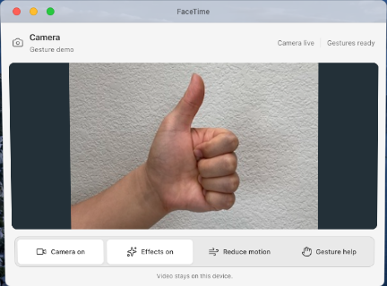
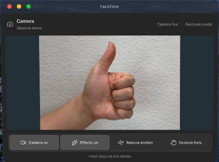

# Camera appearance refinement

The current camera interface uses the same neutral visual language as the portfolio's other macOS-inspired apps.

| Element | Previous Stage 8 design | Current design |
| --- | --- | --- |
| Surfaces | Blue charcoal, mint accents | Neutral silver/light gray or charcoal, following the app theme |
| Status | Bordered green pills with LED dots | Plain secondary text with a subtle divider |
| Controls | Mint camera button and green active states | Gray grouped toolbar, monochrome icons, neutral selected states |
| Feedback and help | Green toast, blue-tinted help panel | Neutral toast and compact help popover; short opacity/position entrance |

| Light | Dark |
| --- | --- |
|  |  |

[Full light view](camera-light.png) · [Full dark view](camera-dark.png) · [Camera off](camera-off.png) · [Narrow window](after-narrow.png) · [Gesture help](after-help.png)

Camera permissions, retry handling, gesture mappings, frame scheduler, GPU/CPU fallback and resource cleanup were not changed. Controls retain 44 px targets (40 px in short windows), keyboard focus and touch support. App/OS reduced motion suppresses the new help/toast entrance as well as particle effects. No additional blur layer was introduced.

Validation: production build/TypeScript and lint pass; 13 effect/scheduler tests pass. The [browser result](ui-results.json) records light/dark appearance, zero status-light elements, neutral surface/control colors, four app window sizes, keyboard/Escape/focus, touch camera toggle, actual-model photo-fixture recognition and reduced motion. The normal-size help panel fits without scrolling. Screenshots use the controlled Google hand-photo fixture documented in the [original Stage 8 report](../README.md#reproducing-the-checks), not a personal webcam.

Reproduce against an isolated local browser and stable build with:

```sh
FACETIME_TEST_FILTER=discoverable FACETIME_STYLE_REVIEW=1 FACETIME_OUTPUT_DIR=../docs/facetime-stage8/refinement/ node tests/facetime-ui.browser.mjs
```
