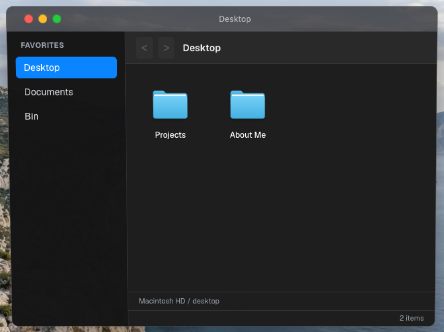
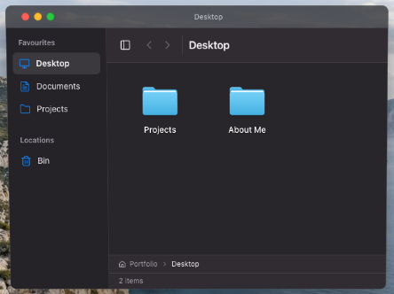

# Stage 3 — Finder interface

The native Finder reference informs the sidebar hierarchy, navigation controls, restrained dividers and location title. The portfolio keeps large folder icons in a grid. The existing WindowFrame still owns the title bar, traffic lights and drag handle.

## Before and after

Both captures use a **640×440 CSS-pixel Finder content area**, a **1440×1000 browser viewport**, the same dark appearance, position and initial Desktop location. The projected frame is approximately 432×320 pixels; each focused screenshot includes the same six-pixel outer margin (444×332 PNG). Full laptop views preserve the actual projected scale.

| Before | After |
|---|---|
|  |  |

- Full projected laptop: [before](before-projected.png), [after](after-projected.png).
- Smaller Finder windows: [480 px](after-480px.png), [360 px](after-360px.png), with the browser viewport kept at 1440 px.
- [Light appearance](after-light-finder.png), [keyboard focus](after-keyboard-focus.png), [drag target](after-drag-target.png), [system reduced motion](after-reduced-motion-finder.png), [app reduced motion](after-app-reduced-motion-finder.png).
- [Projects grid](after-projects-finder.png) shows the three existing project files with wrapping labels.

## Cause and measured response

The slow hover came from the sidebar's **one-second color transitions**. Repeated physical hovers produced **zero Finder or icon renders** before or after this change. No additional loading, caching or blanket memoization was introduced.

| Measurement | Before | After |
|---|---:|---:|
| Configured hover transition | 1,000 ms | 100 ms |
| Observed hover settling | 1,000.5 ms | 100.4 ms |
| First visible response | 15.6 ms | 16.8 ms |
| Selected navigation transition | 1,000 ms color transition configured | 0 ms |
| Finder renders during six hovers | 0 | 0 |
| Finder/icon renders during twelve drag-position updates | 0 / 0 | 0 / 0 |

These are observations in local production Chrome 156, using real pointer events, animation-frame samples, computed styles and a React DevTools commit observer. They are not performance guarantees for other machines. Six after-change navigation clicks committed the new content attribute in 1.5–2.8 ms. The larger `navigationWallTimesMs` values in the raw reports include the harness's intentional 150 ms stable-hit wait and must not be interpreted as application latency. Normal focus and title propagation still render during navigation; the evidence does not identify a rendering bottleneck in hovering.

The existing narrow subscriptions already exclude per-pointer coordinates. Finder now also derives its hovered destination directly and avoids writing an unchanged window title. Shared store architecture and window behavior were preserved.

## Interaction and layout

- Supported destinations only: Desktop, Documents, Projects when available, and Bin. Missing or trashed folders are omitted. No cloud, drive, storage-warning or fake view controls.
- 64 px Finder folder images with wrapping 14 px labels; desktop icon dimensions and drag constants remain unchanged.
- Hover uses a separate 100 ms opacity layer; selection changes immediately. Keyboard focus uses an outline, and file-drop destinations use a dashed accent outline. Theme surface transitions are separate from pointer feedback.
- Single click/Space selects an icon; Enter or double-click opens it. The status bar reflects the selection. Paths follow actual folder ancestry and permit ancestor navigation.
- CSS container queries respond to Finder's own width. The narrow toolbar reflows its title, rather than clipping its controls. Sidebar, path and status visibility preferences remain supported.
- Both the system reduced-motion preference and Settings' Reduce motion switch remove Finder interaction transitions.
- Drag initiation, pointer capture, hit-test attributes, folder data, move/restore/empty actions and navigation remain in the existing implementation. The Bin's item-opening callback checks restore before its hidden-item guard, a small compatibility correction. Renaming and filesystem redesign are deferred to Stage 4.

## Verification

`tests/finder.browser.mjs` exercises the production site through isolated Chrome contexts and physical pointer/keyboard input. Coverage includes repeated hovering/navigation, back/forward, icon grid, selection, Tab/Space/Enter, folder ancestry, sidebar toggle, 640/480/360 px host widths, physical file movement to Documents and back, light/dark appearances, and both reduced-motion preferences. Real clicks verified Projects shows its three files, and Bin shows its empty state, zero count and disabled Empty Bin button.

Raw reports: [before](before-metrics.json), [after](after-metrics.json), [app motion preference](after-app-reduced-motion-metrics.json), [destinations](after-destinations-metrics.json). The React observer tracks committed component work without modifying application stores; it is a diagnostic, not a production dependency. Tests change only the existing host element's width to exercise layout because the current window manager has no manual resize handle.

Production build, lint and TypeScript checks passed, together with all sixteen existing readiness/wallpaper tests and the focused cold-start/Settings-thumbnail browser smoke check. No startup or wallpaper source was changed in Stage 3.

To repeat after checks, run a production preview and a separate Chrome profile with remote debugging, then:

```sh
STARTUP_TEST_URL=http://127.0.0.1:3001 CDP_URL=http://127.0.0.1:9223 node tests/finder.browser.mjs
```

Use `FINDER_TEST_FILTER=app-reduced-motion` or `FINDER_TEST_FILTER=destinations` for the focused checks. Before captures require the previous implementation and `FINDER_PHASE=before`; running that flag against the new implementation cannot recreate the original screenshots. Browser evidence is Chrome-only; Safari and Windows were not directly exercised.
