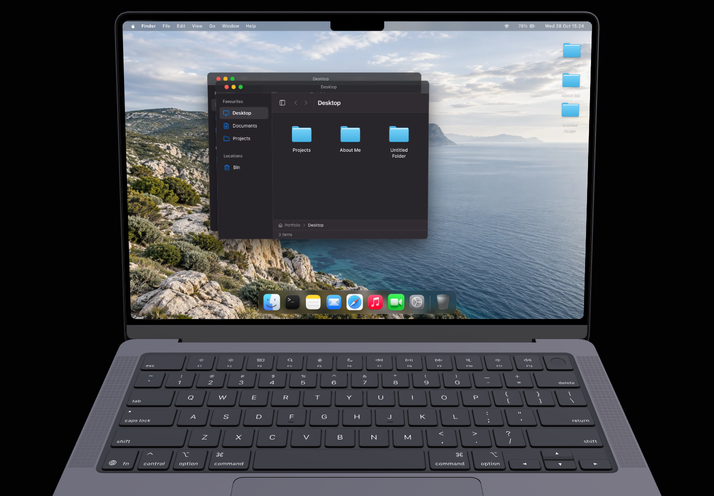
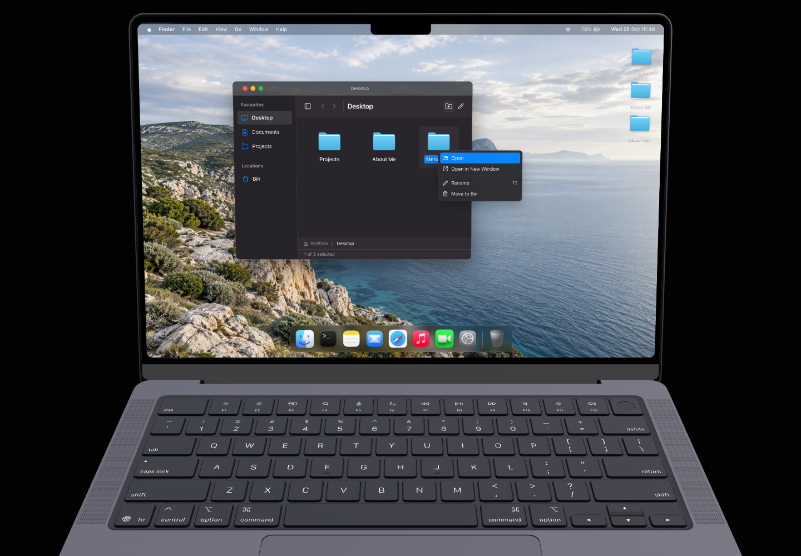
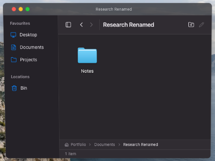
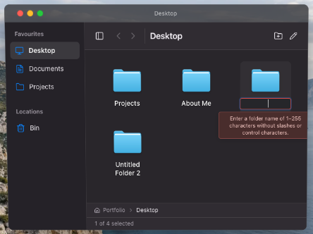
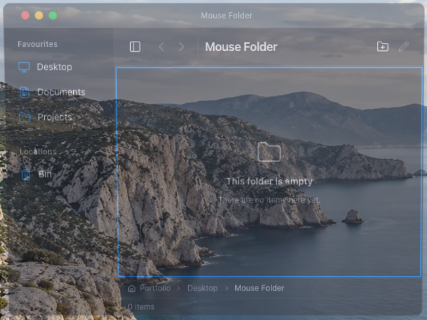

# Stage 4 folder interaction review

The browser harness exercises the actual projected desktop in an isolated Chrome context at 1440 × 1000. It uses physical pointer, secondary click, keyboard, text entry, and drag events through Chrome's debugging protocol. It does not call filesystem actions directly or modify application state.

## Baseline reproduced

On the Stage 3 production preview, File → New Folder created `folder-1793181241453` with the display name `Untitled Folder`. Double clicking that desktop icon opened a Finder window whose content was `desktop`, rather than the new folder's real ID. No inline rename editor existed. A secondary click inside Finder produced an unhandled `contextmenu` event (`defaultPrevented: false`), allowing the browser menu.



The baseline is recorded in `before-browser-results.json`. The old restoration action removed only the requested ID from `trashItems`, leaving descendants hidden after the parent returned. The separate `tests/folders.test.mjs` regression suite exercises the actual filesystem and window stores for identity, restoration, and history behavior.

## Browser acceptance

Run against a production preview with an isolated Chrome debugging endpoint:

```sh
STARTUP_TEST_URL=http://127.0.0.1:3001 CDP_URL=http://127.0.0.1:9223 node tests/folders.browser.mjs
```

`FOLDERS_TEST_FILTER` runs a focused scenario. The full run writes `after-browser-results.json`; focused runs write separate result files. `FOLDERS_PHASE=before FOLDERS_TEST_FILTER=baseline` records the pre-fix behavior.

The suite checks:

- Desktop secondary click → New Folder → inline text selection and rename → open the real folder ID.
- Finder create → rename → open → create nested folder through the File menu → rename parent → move by dragging → trash → restore, preserving parent and child identities.
- Two windows showing one folder receive the same live title, path, contents, and restoration updates.
- Generated name selection, Escape, invalid Enter, duplicate names, valid and invalid blur, and rapid creation with unique names and IDs.
- Physical right click, Shift+F10, arrow navigation and Enter, Escape and outside dismissal, menu containment at four desktop edges, and no drag or unintended open beneath menus.
- Browser context behavior remains available outside the desktop and in another app.
- Ctrl and Meta undo/redo paths, both New Folder modifier combinations, and native text editing undo remaining unhandled by filesystem shortcuts.

Chrome checks the browser-standard secondary-click event used by both a Windows secondary mouse button and a Mac two-finger trackpad click. Modifier paths are simulated separately. These checks do not claim execution on physical Windows hardware or Safari.

## Rename behavior

Enter commits a valid name; an invalid Enter leaves the editor open with an accessible error. Escape cancels the rename. Blur commits a valid name and cancels an invalid edit. Cancelling the initial rename keeps the newly created folder under its generated `Untitled Folder` name. IDs remain unchanged by all name edits.

Sibling name comparisons use normalized, trimmed names and reject duplicates, including differences only in case. Automatic creation fills the first available `Untitled Folder`, `Untitled Folder 2`, and subsequent number in the current destination. A folder in Bin does not reserve its old display name; if Put Back encounters a new sibling with that name, it chooses a free numbered name while retaining the restored ID.

Trash records which root operation each descendant belonged to. Put Back restores that operation's subtree together. Descendants that had already been trashed separately and unrelated Bin items stay in Bin. A descendant cannot be restored inside a still-hidden parent. Undo/redo snapshots retain these origins alongside folder metadata and membership.

## Verified result

All five browser scenarios passed on the final production build in Chrome 156.0.8078.48, including an immediate Escape → next creation shortcut with no artificial focus wait. The final run took 32.1 seconds. `after-browser-results.json` records identities, checks, actual menu bounds and pointer positions, modifier paths, and observed browser event behavior.

| Browser scenario | Result | Time |
| --- | --- | --- |
| Desktop context creation, native text selection, rename and open | Pass | 5.0 s |
| Nested lifecycle and two windows sharing a folder | Pass | 10.5 s |
| Cancel, validation, blur, numbering and rapid creation | Pass | 5.9 s |
| Secondary click, keyboard menu, all four screen edges and browser behavior elsewhere | Pass | 5.9 s |
| Filesystem undo/redo, native text undo and both platform modifiers | Pass | 4.8 s |

Edge checks use `elementFromPoint` to locate the actual projected screen near its corners; a perspective screen's bounding rectangle also contains bezel pixels. Bottom clicks are six physical pixels above the screen bottom, away from the Dock, and force the menu to reposition vertically. Menu rectangles remain inside the desktop with a one-pixel measurement tolerance for perspective rounding. Physical secondary click does not trigger dragging or open a folder underneath the menu.

The project also passed lint, TypeScript checking, and its production build. All 37 combined unit checks passed: 21 targeted filesystem/window regression tests, 12 wallpaper tests, and four startup readiness tests. Store coverage includes 40 rapid creations with stable unique IDs and bounded, wrapped desktop positions, subtree batch restoration without unrelated items, restore-name collisions, undo/redo after rename, and ID-based Finder history across multiple windows. A regression for the audit's exact Projects case checks that all three original project files return under their unchanged IDs, while independently trashed About Me stays in Bin and remains empty.

New desktop folders wrap into available rows and columns above the Dock without moving existing icons. Trashed positions remain reserved for restoration. If every desktop slot is occupied, the fallback remains in bounds but may overlap another icon; the Finder grid still lists the new folder.

No intentional empty portfolio folders were populated.








