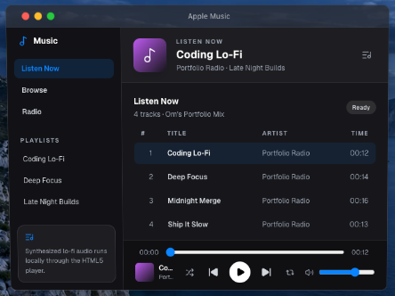
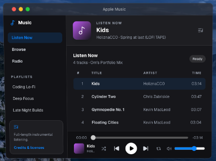

# Stage 5 Music review

The original Music window was captured before implementation, at a **640 × 440 logical content size** inside the projected laptop. The browser viewport is **1440 × 1000**, dark theme, device scale 1. The matching after view uses the same window and browser dimensions.

| Before | After |
| --- | --- |
|  |  |

The original media element used a generated `blob:` WAV source with a measured duration of **12 seconds**. Its four rows displayed **12, 14, 16, and 13 seconds**, all credited to Portfolio Radio. See [the baseline report](before-browser-results.json).

## Results

**14 browser scenarios passed** against the final production build in Chrome 156. The [final browser report](after-browser-results.json) includes the focused [saved-position rerun](resume-browser-results.json). The first timeout probe encountered Chrome's internal media reuse and resumed successfully instead of timing out; the rerun set `Cache-Control: no-store`, disabled caching, and held the actual request before metadata, so the timeout and Retry path were exercised.

| Recording | Native duration | Real seek position | Asset bytes |
| --- | ---: | ---: | ---: |
| Kids — HoliznaCC0 | 194.616984 s | 148.687 s | 3,893,857 |
| Cylinder Two — Chris Zabriskie | 227.832744 s | 174.064 s | 4,557,889 |
| Gymnopedie No. 1 — Kevin MacLeod | 187.088980 s | 142.936 s | 3,742,869 |
| Floating Cities — Kevin MacLeod | 184.058776 s | 140.621 s | 3,682,265 |

The suite covered metadata and elapsed/remaining displays, a natural ending and next-track transition, Previous/Next, repeat, shuffle, keyboard volume, pause, minimize, title-bar close/reopen, Pause during loading, saved-position timeout/retry, File → Close Window, Close All Windows, rapid selection with an older response held, blocked requests, invalid MP3 decoding, rejected Play promises, the browser's actual autoplay restriction, and throttled-network buffering after a seek. Each scenario finished without a runtime exception.

The original and updated window both measure **640 × 440**. The sidebar remains **191 × 440**, header **448 × 91**, content **448 × 263**, footer **448 × 85**, and main artwork **56 × 56**, with the same gradient treatment and 12 px corner radius. The images above were also visually inspected. Entry and an idle open Music window each requested **zero music assets**.

Track permissions, download sources, attribution, encoding, and objective audio checks are recorded in [the provenance review](../music-provenance.md) and [the delivered manifest](../../public/music/manifest.json). Subjective listening was unavailable; no assessment of vocals, harsh changes, or listening quality is claimed. The objective decode, duration, peak, and ending measurements are not a substitute for listening.

## Browser method

The dependency-free [browser suite](../../tests/music.browser.mjs) connects to a separately launched, temporary Chrome profile. It uses physical CDP mouse/key input for app controls. No browser autoplay-policy override is used. Each scenario gets a new browser context with an empty cache, then enters through the existing 3D startup sequence.

Playback duration and seek checks read the actual `HTMLAudioElement`, rather than trusting track labels. End-of-track checks seek near the end and allow the browser to emit its real `ended` event; they do not dispatch a synthetic event. Network failure tests block the real asset request or fulfill it with an invalid audio body. The rejected-play scenario deliberately returns one `NotAllowedError`; a separate pre-interaction probe checks Chrome's actual autoplay restriction.

The buffering check throttles a real media request, seeks beyond the available buffer, observes a native `waiting` event after the seek, restores throughput, and verifies playback recovery. The close test keeps a reference to the detached media element only for inspection and verifies that it is paused and has no source, while the reopened app has just one new player.

The saved-position regression holds a resumed request before metadata arrives and accelerates only the playback controller's 12-second failure deadline. It verifies that the stored **148.799-second** position survives the timeout and that Retry resumes at **148.801 seconds**. Separate menu checks exercise both File → Close Window and Apple → Close All Windows while another app has focus.

This is functional testing in headless Chrome on macOS. It does not establish physical Windows, Safari, or audio-device compatibility. Listening and source/licensing review are documented separately from browser acceptance.

## Playback lifecycle

- Opening Music mounts one native audio element with `preload="none"` and no source. Opening the app and desktop startup download no music files.
- A user clicks Play or a track to assign only the selected source. The native media element reads metadata and streams the compressed recording. Playback and seeking use the browser's real duration.
- Minimizing keeps Music mounted and playing. Pause also cancels pending playback while a source is loading.
- The title-bar Close action immediately pauses, removes the source, and releases playback listeners/timers before its window animation finishes. File → Close Window and Close All Windows trigger the same cleanup through a narrow window-store subscription.
- Cleanup is idempotent. Reopening retains the selected track and saved position while staying paused and source-less until Play is clicked. It creates one player and never regenerates or decodes a library of full tracks.

## Running

With a production preview on port 3001 and a separate Chrome debugging profile on port 9223:

```sh
STARTUP_TEST_URL=http://127.0.0.1:3001 CDP_URL=http://127.0.0.1:9223 node tests/music.browser.mjs
```

`MUSIC_TEST_FILTER` selects a scenario. `MUSIC_REPORT_NAME` can save a focused report separately. The original baseline is retained in `before-browser-results.json`; a complete run writes `after-browser-results.json`.
