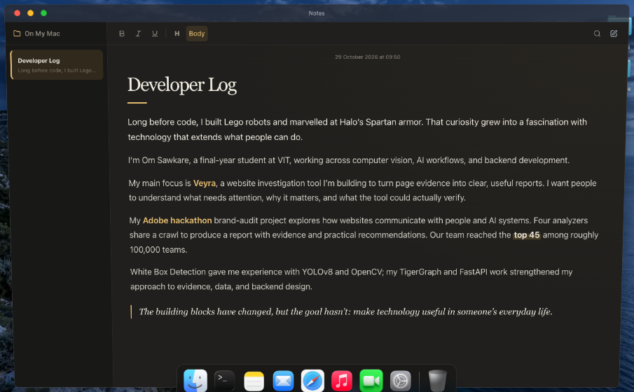
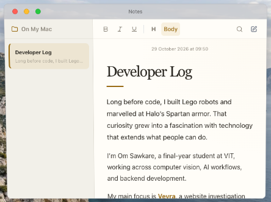

# Notes visual refinement

The approved Developer Log wording is unchanged. Its presentation now uses a serif heading, warm paper colors, restrained gold emphasis on Veyra and Adobe, a highlighted “top 45,” and an italic closing paragraph. Ordinary note editing and session-only storage remain in place.

| Detail | Before | After |
| --- | --- | --- |
| Maximized alignment | Narrow column centered far from the sidebar | Full-width writing area with a 40 px left gutter |
| Maximized body | 15 px | 18 px; normal window uses 16 px |
| Title and emphasis | Uniform sans-serif treatment | Georgia title, short amber rule, selective project emphasis |
| Motion | No editorial entrance | One 300 ms page entrance and 380 ms title-rule reveal; both disabled with reduced motion |

Measured maximized editor width is 1,024 px inside a 1,104 px content area. The earlier centered layout measured 592 px with a 252 px left inset. Before/after captures use the same 1,440 × 1,000 browser viewport.

## Views

| Window | Before | After |
| --- | --- | --- |
| Normal | [Before](before-normal.png) | [After](after-normal.png) |
| Maximized | [Before](before-maximized.png) | [After](after-maximized.png) |

## Verification

Production build, TypeScript validation, and lint passed. All seven focused browser scenarios passed in Chrome 156 on macOS; [actual results](browser-results.json).

- Open, create, and switch notes; original window dimensions preserved.
- Clear Note updates the visible editor; typing cannot resurrect stale HTML.
- Middle-of-text typing preserves the caret; bold, native undo, and redo work.
- Search, no-match results, clear search, and Escape work.
- Edited seed and visitor notes survive close/reopen; reload retains the existing memory-only policy.
- Exact approved prose equality, normal/maximized layout, and narrow container probes at 520 and 420 px pass without horizontal overflow or clipped toolbar buttons.
- Real Settings theme changes update both palettes; reduced-motion preferences disable the entrance effects and editing remains usable.

The small-width checks are controlled container layout probes, not a claim of physical trackpad resizing. Safari and Windows were not exercised in this pass.

## Final review

Applied `ecc:make-interfaces-feel-better` and `ecc:agent-self-evaluation`.

| Axis | Score | Evidence and remaining improvement |
| --- | --- | --- |
| Accuracy | 4/5 | Production build, exact prose comparison, and seven browser scenarios passed; a Safari pass would add browser coverage. |
| Completeness | 4/5 | Typography, emphasis, subtle animation, maximized alignment, both themes, reduced motion, and editing are covered; physical resizing was not automated. |
| Clarity | 4/5 | Concrete before/after views and measured layout changes are supplied; the preferred visual treatment remains a user judgment. |
| Actionability | 5/5 | Changes are implemented locally, with a working production preview and linked screenshots. |
| Conciseness | 4/5 | Detailed evidence is kept here; the final response can focus on the visible result. |

Overall: 4.2/5. No critical issues. Highest-value future verification is Safari at the same window sizes. Self-check: the implementation addresses the requested visual polish while preserving the writing; the user should judge the aesthetic from the supplied previews. Deliver as implemented.
