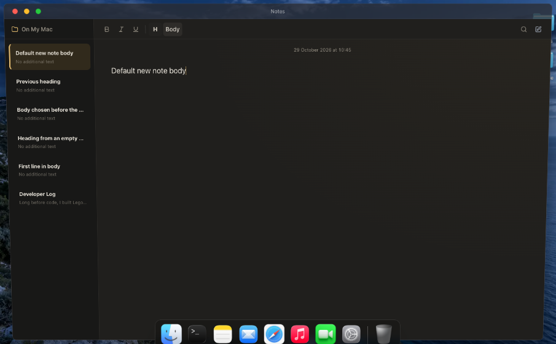

# Notes first-line formatting fix

Formatting commands now focus the current editor and restore an in-editor caret when the previous range belongs elsewhere. A new blank note gets a fresh caret. The toolbar reads heading state from the current note's actual selection. The first paragraph no longer overrides the body font size.

Production build (including TypeScript) and focused lint passed. All six browser scenarios passed in Chrome 156: [results](after-browser-results.json).

The new regression exercises Body before the first character, Heading before typing, Heading → Body before typing, converting an existing heading back to Body, a new note after a heading, and normal/maximized sizes. Actual sizes are 16 px Body / 36 px Heading normally and 18 px Body / 40 px Heading maximized. Existing caret, bold, undo/redo, clear, search, switching, and session-storage checks also passed.

The pre-fix Chrome reproduction confirmed a 16.64 px first-paragraph override against the 16 px body size: [baseline](before-browser-results.json). The much larger Safari text shown in the user's screenshot was not reproduced in Chrome. Selection ownership was also corrected to prevent commands from acting on an old or unrelated range. Safari WebDriver could not create a test session because “Allow remote automation” is disabled; no Safari settings were changed.

