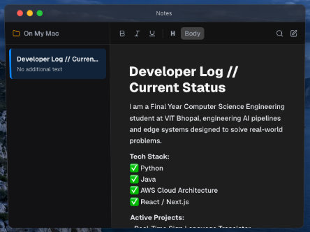
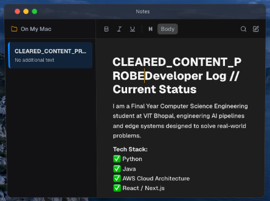
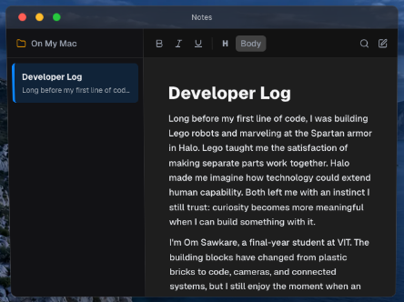
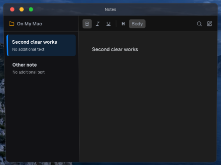

# Stage 6 Notes review

The baseline was captured in an isolated Chrome profile at a 1440 × 1000 browser viewport, with the app rendered inside the actual projected laptop desktop. The original Notes window measured 642 × 478 local pixels including its title bar and borders.

## Reproduced defect

`Clear Note` changed the stored content and sidebar preview to an empty note, but the visible rich-text editor still showed its old HTML. Typing into that editor wrote the stale content back into the note. [Baseline results](before-browser-results.json) record the exact old HTML, cleared sidebar, and resurrected content.

## Verification

All five [after-change browser scenarios](after-browser-results.json) passed against the rebuilt production preview:

- The default story opens in the original 642 × 478 local window; switching between it and a visitor-created note preserves both.
- Clear Note immediately empties the visible editor. Typing afterwards contains only the new words; clearing again and switching do not resurrect old HTML.
- Inserting words in the middle preserves the caret. Bold formatting, browser-native undo/redo, and switching away/back preserve the expected HTML.
- Case-insensitive search, no-match state, clearing the query, and Escape work.
- An edited seed and visitor note survive closing/reopening without being reset. Neither is written to localStorage/sessionStorage; reloading retains the established fresh-seed, memory-only behavior.

The complete seeded prose is in [Developer Log](../developer-log.md); the evidence for its factual claims is in [the source map](../notes-sources.md).

These checks exercise Chrome's real contenteditable editor and pointer/keyboard input in the projected desktop. They do not claim physical Safari, Windows, or trackpad testing.
