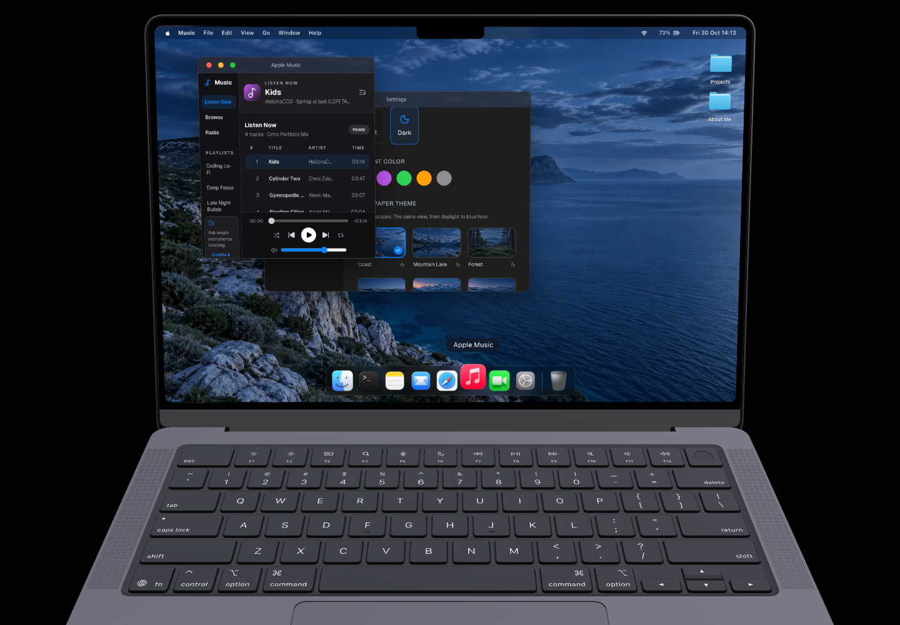

# Stage 12 — integrated production verification

Scope: measure the completed portfolio together and correct reproduced integration problems. No new apps, placeholder content, renderer architecture or product features were added.

## Test conditions and interpretation

30 October 2026. Actual host: MacBook Air M1 (`MacBookAir10,1`), 8 GB RAM, 8 CPU cores / 7 GPU cores; macOS 27.2, build 26B123, Darwin 27.2.0 arm64. Actual browser: Chrome 156.0.8078.76, ANGLE Metal Apple M1. The OS power query reported AC Power and low-power mode 0 at verification time; power and temperature were not controlled. An isolated headless browser used this machine's GPU. This is not a physical-display, trackpad, real-camera, Windows or Safari hardware run.

Production baseline: `YDm78Ayaf0KK_VzrB0uGz`; final: `tn56yDtmK_Ro_VJQn75ci`. Both used `next build` + `next start` on `http://127.0.0.1:3012`. No development-mode timing is used. The primary viewport was 1440 × 1000 CSS pixels, DPR 1; a separate renderer test mounted at DPR 2 with a verified 2880 × 2000 drawing buffer. Narrow coverage used a 390 × 844 viewport and 420 × 478 virtual app-window fixtures. Those fixtures test layout; the existing window manager has no pointer resize handle. Maximize/restore and viewport bounds refitting were exercised normally.

Cold sessions use a fresh browser context and clear HTTP cache; warm sessions reload the same context. The GPU/shader cache and operating-system filesystem cache were not cleared between runs. The baseline's first cold run is therefore an outlier to retain, not a valid isolated optimization win. Throttled startup configures 60 ms network latency, 1,250,000 bytes/s download and 125,000 bytes/s upload through CDP. This is simulated networking to a local server. The final first startup also includes initially uncached server image optimization; later runs reuse those server derivatives.

Frame numbers are browser `requestAnimationFrame` interval distributions, not GPU completion or presented FPS. Pointer-to-next-rAF and Event Timing/input delay are local lab probes, **not field INP**. The roughly 16.7 ms frame and <200 ms interaction goals are comparison targets. Main-thread busy percentages use `TaskDuration / elapsed time`, not whole-machine CPU utilization. Startup readiness means the loader has gone and the Notes Dock target passes hit testing, followed by an actual successful app-opening click. Optional assets need not all have finished.

## Reproduced problems and bounded changes

- Notes and Settings cancelled every wheel event. This incorrectly turned Ctrl/pinch input into vertical scrolling and swallowed horizontal/Shift wheel gestures. Their custom wheel hook was removed; native overflow scrolling, gesture defaults and scroll chaining are retained. No new wheel interceptor replaces it.
- At 420 virtual pixels, Settings had a 247 px scroll width inside a 226 px content area and clipped a wallpaper-mode control. Music's volume slider fell outside its frame. Container-based rules now wrap the necessary controls and reduce sidebar width without changing the wide layout or playback lifecycle.
- The nine visible Dock images downloaded 3,186,884 encoded bytes despite a default 56 px footprint. The existing Next image optimizer now serves size-appropriate derivatives from the same local artwork. Original artwork and Dock geometry remain intact.
- The touched app transitions now honor both OS and in-app reduced motion. Settings navigation settles in 100 ms with visible keyboard focus.

## Measured results

Decimal MB/KB below. Baseline desktop matrix: 76.31 s plus a separate 17.29 s Retina rerun and native-wheel confirmation. Final desktop matrix: 85.32 s, 9/9 scenarios passed; separate four-app resource run: 26.82 s, 1/1 passed. Final camera scenarios took 38.41 s and 24.39 s, including 28.11 s of deliberately measured combined workload. The per-scenario JSON supplies actual timestamps and sample counts. Builds/checks were not run during the reported timing windows; the standalone Retina baseline was repeated in isolation after compiler checks.

| Measurement | Before | After | Interpretation |
| --- | ---: | ---: | --- |
| Nine initial Dock images, encoded body | 3,186,884 B | 13,016 B | 99.6% smaller at DPR 1; same artwork, size-appropriate derivatives |
| Observable resource encoded-body sum, cold context | 14.922 MB | 11.749 MB | 3.173 MB reduction in resource-entry accounting; includes optional/repeated entries, excludes HTML and opaque cross-origin sizes |
| Cold usable desktop, median of 3 | 1.565 s | 1.488 s | Small lab difference, not a robust speed claim; see all samples below |
| Returning desktop, median of 3 | 1.650 s | 1.321 s | Same-context reload; shader/server-cache and run variability remain |
| Cold, 10 Mbps / configured 60 ms latency | 11.768 s | 11.687 s | One sample each: effectively unchanged; larger scene assets still dominate this slow-network path |
| Idle rAF interval p95 / max, DPR 1 | 16.7 / 16.8 ms | 16.8 / 16.8 ms | 8 s windows; zero long tasks |
| Four-app interaction rAF p95 / max | 16.8 / 200.1 ms | 16.8 / 16.8 ms | Zero long tasks in both; single-run stall reduction is not an isolated causal optimization result |
| Four-app local Event Timing p95 / max | 256 / 272 ms | 48 / 56 ms | Includes maximize/minimize/restore events; not field INP; baseline missed the 200 ms goal |
| Four-app pointer → next rAF p95 | 1.9 ms | 2.1 ms | 210 pointer samples per run; no measured drag speedup |
| DPR 2 idle / drag rAF p95 | 16.7 / 16.8 ms | 16.8 / 16.7 ms | True 2880 × 2000 rendering; zero observed long tasks |
| Finder navigation local Event Timing p95 | 32 ms | 48 ms | Short 9-navigation samples; both under the local target, no claimed improvement |
| Wallpaper/theme local Event Timing p95 / max | 248 / 256 ms | 48 / 48 ms | Six rapid choices plus light/dark; baseline 200 ms rAF gap did not recur; six final thumbnails valid |
| Settings content scroll/client width, 420 px app | 247 / 226 px | 286 / 286 px | No horizontal content overflow; wallpaper-mode controls fit |
| Music narrow volume control | Outside frame | Inside frame | Previous/play/next/volume all visible and inside the app |
| Notes/Settings modified wheel | Cancelled | Native defaults retained | Ordinary trusted wheel scrolled 160 / 120 px; synthetic Ctrl/Shift/horizontal events no longer cancelled |
| Camera + effects + Music + drag, rAF p95 / max | 16.7 / 83.3 ms | 16.7 / 16.8 ms | Real model with photo-fed video; 180 drags; one baseline 84 ms long task, none observed after |
| Above, inference rate / native inference p95 | 9.77/s / 23.7 ms | 9.83/s / 22.6 ms | Camera runtime unchanged; ordinary run variability, not a camera optimization claim |

All cold values before: **5.366, 1.565, 1.516 s**; after: **1.577, 1.392, 1.488 s**. All returning values before: **2.164, 1.650, 1.510 s**; after: **1.294, 1.327, 1.321 s**. The original first cold/shader outlier remains in the report. Uncached server image derivative generation took 133–181 ms per Dock image on the first final request, versus roughly 3–7 ms on subsequent local requests. This did not trap the readiness coordinator.

Critical startup requests remain the model description, 8,293,480 B model binary, model textures, selected 159,880 B Coast dark wallpaper and HDR environment. No other full wallpaper variant or camera model/WASM was needed for entry. The HDR request uses the existing `raw.githack.com/pmndrs/drei-assets` host: first-run duration was 526 ms before / 246.5 ms after, and Resource Timing exposes zero encoded size because of cross-origin timing restrictions. That is an **unknown size**, not a zero-byte asset. The encoded-body sum also contains repeated selected-wallpaper resource entries, so it is not an exact unique wire-byte total. The nine cold Dock requests are counted individually once. Existing external HDR dependency, shader-cache state and run-to-run network changes prevent attributing small startup differences solely to Dock optimization.

Idle main-thread busy proxy increased from 8.45% to 10.43%; the four-app window changed from 12.73% to 13.97%. These runs do **not** establish reduced CPU consumption. Camera combined busy proxy was 31.22% before and 29.81% after, with unchanged camera runtime and no claimed causal improvement. The broader baseline effect sample had two long tasks (largest 155 ms) and a 166.6 ms rAF gap. Those did not recur in the final sample, but their cause was not isolated; native inference maxima were shorter than the largest task.

## Cleanup, controls and layouts

The final ordinary-app test opened and closed Finder, Notes, Music and Settings eight times each. After cycles 1, 2, 4, 6 and 8: **286 DOM nodes, 570 listeners, zero app/audio/video elements, one scene canvas, one pending scene rAF and zero video callbacks**. GC-assisted heap grew 12,630,908 → 13,305,436 bytes (+0.675 MB), with much less growth in the last cycles. Test-owned event histories were cleared before GC. This is a short trend, not proof of an indefinitely flat heap.

The separate real-model camera lifecycle test held **405 nodes / 579 listeners** through eight reopen cycles; GC-assisted heap grew **13.486 → 14.117 MB**. Closed samples contained zero media tracks, gesture/effect callbacks, effects or Music audio nodes. Inference stopped while hidden or closed. One shared 3D scene canvas remains intentionally active. Permission denial/retry and page hide/restore use controlled fixtures; native hardware prompts are not tested.

Trusted keyboard Enter opened About Me; an emulated touch tap opened Notes. OS and in-app reduced-motion checks yielded zero transition duration in touched app roots. All six final wallpaper previews loaded from dedicated thumbnail paths. The 390 px viewport retained an accessible on-screen Dock position. Browser page scaling at 1.25 and DPR changes were exercised; this is not native browser zoom.

Same 420 × 478 virtual app-window sizes: [Settings before](baseline-settings-420.png) / [after](after-settings-420.png), [Music before](baseline-music-420.png) / [after](after-music-420.png). Scroll offsets differ because the native-wheel check occurs before capture. More layouts: [four apps](after-four-apps.png), [Notes narrow](after-notes-420.png), [390 px viewport](after-viewport-390.png), [wallpaper Settings](after-wallpaper-settings.png), [combined camera/effects/Music](camera/after-combined-after-measurement.png).



## Checks

- [Production build](after-build.txt): passed, Next 16.3.1, compilation 4.1 s.
- [ESLint](lint.txt): passed without warnings.
- [Type check](typecheck.txt): passed.
- [Targeted store/runtime/geometry regressions](unit-tests.txt): **193/193 passed**.
- [Startup readiness coordinator](readiness-tests.txt): **4/4 passed**. Node reports its existing module-type warning; no module/package changes were introduced to suppress it.
- [Desktop production matrix](after-results.json): **9/9 passed**; [eight ordinary-app cycles](after-normal-app-results.json): **1/1 passed**.
- [Camera combined/lifecycle matrix](camera/after-results.json): **2/2 passed**. Compressed traces and full before/after distributions are retained in the camera directory.
- [Loader/recovery production checks](startup-checks.txt): **8/8 passed**, including failed model/lighting, wallpaper fallback, unavailable WebGL, context loss, stalled-lighting deadline and retry. Screenshots are in `startup/`.
- Notes production checks passed **8 distinct cases** (18 executions across editing, first-line formatting and design runs): [editing](notes/after-browser-results.json), [formatting](notes/format-browser-results.json), [layout/themes/motion](notes/design-browser-results.json). Native text undo, clear synchronization, approved prose and memory-only note policy are preserved.

Raw desktop comparison: [baseline](baseline-results.json), [isolated true-DPR2 baseline](baseline-retina-results.json), [native-wheel baseline](baseline-wheel-results.json), [final](after-results.json). Repeated checks of untouched behavior were limited to the requested flows and regression suite.

## Evidence and reproduction

Run serially against a production preview and an isolated Chrome CDP endpoint; do not benchmark while compiling or running another browser workload:

```sh
STARTUP_TEST_URL=http://127.0.0.1:3012 CDP_URL=http://127.0.0.1:9229 STAGE12_PHASE=after node tests/stage12-performance.browser.mjs
STARTUP_TEST_URL=http://127.0.0.1:3012 CDP_URL=http://127.0.0.1:9229 STAGE12_PHASE=after node tests/stage12-camera.browser.mjs
```

`STAGE12_PHASE` labels evidence; it does not switch source/builds. Check each JSON build ID. `STAGE12_FILTER` selects desktop scenarios; `STAGE12_CAMERA_FILTER` selects camera scenarios. The camera harness needs the documented test-only JPEG fixtures. See [camera methods, lifecycle samples and raw traces](camera/README.md).

## Deliberately retained implementation

The scene still renders continuously at about 60 renders/s. Lowering DPR or shadows was not justified by the measured idle/drag cadence. Enabling demand rendering would need complete wake/settle verification for camera movement, scene loading, readiness probes, keyboard animation, viewport changes and page restoration; it was not switched on speculatively. Existing shadows do not create a demonstrated shadow-map bottleneck in this model.

Secondary-app loading was assessed: the isolated MediaPipe SDK is about 45 KB gzip and the model/WASM already load on camera intent. Its entire combined scene bundle is not camera-only code. No measured startup long task justified restructuring that bundle here. Dragging already uses MotionValues, with store position committed at release, so there was no per-pointer store rerender problem to justify broad memoization or state rewrites.

## Remaining hardware checks and reproduction steps

1. On Windows 11 Chrome and Edge and native macOS Safari, record the exact browser/OS, device and power mode. Clear site cache, open the production deployment, then reload. Verify one-click access after the loader. Repeat on a realistic network rather than localhost alone.
2. With physical camera hardware, allow, deny, dismiss and retry permission; test a busy/unavailable camera. Hold each supported pose, remove the hand and re-enter. Play Music, trigger effects and drag Notes over FaceTime. Repeat after minimizing, hiding the tab, closing and reopening eight times. Confirm the camera indicator turns off and no audio/inference persists after close. Recorded-photo fixtures do not prove these hardware paths.
3. Exercise real GPU-to-CPU recovery on Windows ANGLE/driver combinations and block model/WASM requests. Confirm useful errors and retry. The final browser fixture suite can validate controlled failures but cannot simulate a real driver reliably.
4. Use native browser zoom at 80%, 100% and 125%, a physical mouse/trackpad, trackpad pinch, horizontal/Shift scrolling and momentum scrolling through Notes/Settings boundaries. CDP page scale, wheel and touch events are partial coverage, not native toolbar zoom or physical-input evidence. At a 390 px viewport the projected desktop fits, but its scaled controls remain small; no separate mobile redesign was introduced.
5. Slow-network entry still takes about 11.7 s: reproduce with `STAGE12_FILTER=startup-10Mbps STAGE12_PHASE=diagnostic` using the desktop command above, or clear site cache and apply 10 Mbps / 60 ms latency before navigation. The loader remains usable; the 8.29 MB model binary and external HDR dependency remain. Occasional baseline stalls also remain an unresolved risk: run the `combined-scene` camera filter, play Music, change thumb to peace and drag Notes; see the [bounded trace attribution](camera/README.md#bounded-offline-trace-attribution). They did not recur in the final sample and are not proven fixed. The desktop matrix's repeated Settings maximize/restore and six rapid wallpaper choices are the corresponding reproduction paths for its baseline 200 ms gaps.

Intentional empty folders, Neural Block and unfinished games remain unchanged. Optional product ideas and a future battery/idle-rendering investigation belong in a later backlog.
