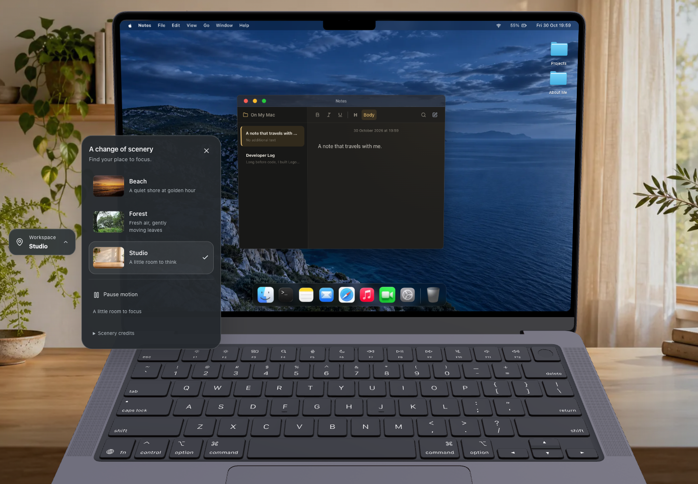

# Stage 13 — places to work

Three environments now surround the existing MacBook: a moving sunset Beach, a moving Forest and a static warm Studio. The laptop, screen wallpapers, apps, camera placement and desktop coordinate system remain independent of location. The left-side Workspace control opens a small location picker, pause/resume control and scenery credits.

Final preview: **http://127.0.0.1:3012**. Measurements below used the isolated preview on port 3013; the same verified build was then moved to the existing preview address. The development server was not stopped or reconfigured.

## Implementation

- One page-level media backdrop sits behind the existing transparent Canvas. The original opaque scene background was removed; model lighting, fog, camera and renderer architecture remain intact. No extra WebGL renderer was introduced.
- Selected local posters load after preference hydration. Only the current video's source is requested initially, after the critical scene is usable. The collection is not a loader dependency. Dedicated previews mount when the picker opens.
- Every new destination prepares its decoded poster and, for live motion, an accepted playback request plus an actual presented video frame. The previous scene remains visible during preparation and on failure. Initial autoplay failure leaves a usable still image with Retry.
- The 800 ms travel effect uses background zoom, a crossfade and restrained warm radial streaks. The laptop stays anchored and interactive. Decoded video frames freeze during travel, then live motion resumes at arrival. The temporary streak layer and outgoing media are removed afterward.
- A bounded transition coordinator keeps at most two media layers. A new choice cancels earlier preparation; during an active flight only the latest queued choice is retained. Stale readiness/failure/completion events cannot replace the latest destination.
- Backgrounds are muted files with **no audio tracks**. Pause freezes the current frame. Page hide pauses playback; restoration resumes when browser policy permits. Reduced motion uses still posters and immediate location changes. Retired players are paused, stripped of `src` and reset.
- Only the successfully displayed location is persisted under `portfolio-workspace` using the appearance store's explicit hydration/narrow-write pattern. Pause, playback, transitions, window/drag state and visitor notes are not persisted. Pause lasts for the current page session.

Source: `src/components/workspace/`, `src/data/workspaces.ts`, and the bounded integration in `src/components/webcam/MacBookScene.tsx`.

## Assets and permission

All delivered media is served from `public/workspaces/`; there are no runtime third-party video hotlinks.

| Location | Motion asset | Poster | Dedicated preview |
| --- | --- | ---: | ---: |
| Beach | H.264 Main, 1280 × 720, 24 fps, 7.25 s; **2,393,930 B** | 42,318 B, 1280 × 720 WebP | 1,474 B, 160 × 100 WebP |
| Forest | H.264 Main, 1280 × 720, 24 fps, 15.0 s; **3,559,203 B** | 229,538 B, 1280 × 720 WebP | 5,168 B, 160 × 100 WebP |
| Studio | Static original generated artwork | 79,898 B, 1600 × 900 WebP | 1,968 B, 160 × 100 WebP |

The Beach and Forest are actual footage with stationary camera compositions. The original clips were trimmed, stripped of audio/metadata, encoded for fast-start MP4 playback and given short wrap crossfades. The high-detail Forest needs more bytes than Beach; its bitrate was bounded rather than serving the initial 8.44 MB encode. 720p is an intentional background/decode-cost tradeoff: exposed scenery is softer than the portfolio's foreground. These scenes are not presented as 4K video. The Studio master is retained at [sources/studio-master.png](sources/studio-master.png).

Beach: [Ruben Velasco's original item](https://mixkit.co/free-stock-video/view-from-a-calm-beach-during-a-sunset-44498/) and [creator profile](https://mixkit.co/@rubenvelasco/). Forest: [original item](https://mixkit.co/free-stock-video/the-wind-gently-moves-the-forests-lush-vegetation-on-a-50870/), credited to the Mixkit account; no individual camera operator is named there. Both item pages explicitly designate the [Mixkit Stock Video Free License](https://mixkit.co/license/modal/videoFree/), which permits this incorporated website use and editing without mandatory attribution, subject to [Mixkit's terms](https://mixkit.co/terms/). Voluntary credits are shown in the picker. The assets are not offered as a stock library or resold. Verified 30 October 2026.

[Machine-readable provenance](../../public/workspaces/provenance.json) records source/download URLs, creator identity as available, permission/attribution conditions, modifications, measured durations, sizes and SHA-256 digests. The generated Studio uses no external stock photograph; applicable image-generation provider terms still apply.

## Actual test conditions

30 October 2026, actual MacBook Air M1 (`MacBookAir10,1`), 8 GB RAM, macOS 27.2 / Darwin 27.2.0 arm64. Chrome **156.0.8078.76**, isolated headless instance using ANGLE Metal on Apple M1. Primary viewport 1440 × 1000, DPR 1; a final Retina check mounted a genuine 2880 × 2000 Canvas at DPR 2. Selector layout/input checks additionally used 1440 × 600, 800 × 600, 390 × 844 and 320 × 568. Mouse, keyboard and touch events are trusted CDP input. Native trackpad/touch hardware is not implied.

The original black-background production build was `tn56yDtmK_Ro_VJQn75ci`. An initial workspace build was `YhpR266_Aktf2u8bfBJ7N`; final optimized build is `KxiCD18wWgf5YdBASmnGe`. All timing uses `next build`/`next start`, unthrottled localhost with media warmed before steady-state profiling. Entry tests use fresh browser contexts and clear HTTP cache. GPU/shader/filesystem caches were not cleared; temperature and power were not controlled. The isolated browser was restarted after one inspection-session timeout before final acceptance.

Measurements are **local lab observations**, not field INP or GPU presentation/completion measurements. Frame distributions use rAF intervals; pointer latency is listener-to-next-rAF. Busy percentages are main-thread TaskDuration/elapsed-time proxies, not whole-system CPU consumption. No physical webcam, native Safari or Windows device was used. Camera stress checks run the real MediaPipe model/classifier against labelled photograph fixtures supplied through native video, with real Music playback and trusted Notes dragging.

## Measured observations

The black-background desktop run took 24.718 s; final corresponding run took 25.292 s. Each includes an 8 s idle sample and about 8.4 s of dragging/maximize/minimize with Finder, Notes, Music and Settings open. Black and final camera runs measured 28.111 / 28.289 s of actual combined workload; setup/recording included, their combined scenarios took 38.958 / 49.010 s. The final camera lifecycle scenario took another 27.884 s. The final eight-case workspace matrix took 92.142 s. No build, media encoding or competing test ran during these measured windows.

| Workload / metric | Black background | Live environment / final |
| --- | ---: | ---: |
| Idle scene rAF p95 / max | 16.7 / 16.8 ms | 16.7 / 16.8 ms |
| Four apps + dragging/maximize/minimize rAF p95 / max | 16.7 / 16.8 ms | 16.7 / 16.8 ms |
| Four-app pointer → next rAF p95, 210 samples | 2.5 ms | 3.1 ms |
| Four-app local Event Timing p95 | 40 ms | 32 ms |
| Camera + effects + Music + dragging rAF p95 / max | 16.8 / 33.4 ms | 16.8 / 33.4 ms |
| Same combined workload, inferences/s | 9.76 | 9.85 |
| Same combined workload, native inference p95 | 23.9 ms | 24.4 ms |
| Same combined workload, pointer → next rAF p95, 180 samples | 14.4 ms | 2.5 ms |
| Observed long tasks in those desktop/camera samples | 0 | 0 |

These are individual controlled runs, not a general speedup claim. The new visuals have a cost: the idle main-thread busy proxy rose **10.51% → 13.45%**, and the four-app proxy **15.64% → 17.65%**. The combined camera proxy was **31.97% → 30.95%**; camera code was unchanged, so that difference is run variability rather than a camera optimization. Power/thermal conditions were not held constant. Occasional 33.4 ms gaps remain in the camera workload; no hardware-wide 60 FPS claim is made.

In separate 8 s live-view samples, Beach and Forest rAF p95 were **16.7 / 16.8 ms**, with max 16.8 ms and zero long tasks. The initial implementation's six-location travel sample had **33.3 ms p95 / 33.4 ms max**. Freezing decoded video during the brief travel effect and pre-promoting its temporary streak layer produced **16.8 ms p95 / max** in a focused 6.096 s trial, then again in the final 6.174 s six-change sample. Final travel Event Timing p95 was 32 ms, and zero long tasks were observed. The clip resumes at arrival; this tradeoff avoids spending decoder/compositor work on environmental motion that the travel effect masks. The initial measurement is retained as evidence rather than claiming the first version was already smooth.

Cold-context usable desktop in the final entry case was **1.803 s**; an earlier workspace-build entry check was 1.559 s. The selected Beach poster started at about 0.2 s, and its video source was requested only after scene readiness (about 0.9 s in that earlier sample). No Forest/Studio full-size media or selector thumbnails were requested at initial entry. These startup samples are not a statistically meaningful startup-speed comparison against black; optional video is not in the readiness gate.

The additional [Retina check](after-retina-results.json) took 19.296 s. At verified 2880 × 2000 rendering with Beach motion, idle/drag rAF p95 were **16.8 / 16.7 ms**, max 16.8 ms, with zero observed long tasks; 210 drag samples had 2.6 ms pointer-to-next-rAF p95. It is an after-only coverage check, not a DPR 2 speedup comparison.

## Cleanup and checks

Eight full Forest → Beach → Studio cycles left **256 DOM nodes / 574 listeners** at every GC-assisted sample. In Studio there were zero background video nodes, one environment layer, one existing scene canvas, one pending scene rAF and zero video-frame callbacks. Retired video weak references were collected. JS heap rose **11.643 → 11.953 MB** (+0.310 MB); this short trend is not a long-term leak proof.

The camera lifecycle's eight reopen cycles retained **569 nodes / 613 listeners** with the background present. GC-assisted heap rose **13.495 → 14.197 MB**; camera tracks, gesture callbacks/effects and Music audio nodes were zero after closing, while the background and one 3D scene intentionally remained. Hidden/closed camera inference was zero.

- [Production build](build.txt): passed, with the existing MediaPipe package/runtime/checksum prebuild check.
- [ESLint](lint.txt) and [TypeScript](typecheck.txt): passed.
- [Regression checks](regression-tests.txt): **208/208 passed**, including 11 new workspace/asset cases.
- [Workspace production acceptance](workspace-browser-checks.txt): **8/8 passed**.
- [Comparative four-app run](desktop-checks.txt): passed.
- [Camera stress and lifecycle](camera-checks.txt): **2/2 passed**.
- [Preserved startup/recovery checks](startup-checks.txt): **8/8 passed**.

Acceptance covers every location; a real media ending/loop; rapid choices during preparation and flight; blocked poster/video recovery; rejected play promises; pause/resume; controlled page hide/restore; reduced motion; keyboard/focus/Escape; touch; narrow controls; persisted location and independent desktop wallpaper; unchanged Canvas/Desktop identities and a visitor note retained through switching. The tests do not infer Windows/Safari support from this Mac Chromium run.

## Review artifacts

- [Beach](after-beach.png), [Forest](after-forest.png), [Studio](after-studio.png), [picker](after-studio-picker.png), [390 px layout](after-narrow-390.png).
- [Watch the recorded travel transitions](travel-demo.mp4): actual production-page screencast, Beach → Forest → Studio. The 1152 × 800 MP4 is 4.2 s / 796,010 B, encoded from 125 captured frames spanning 4.133 s. Capturing was separate from the timed performance windows.
- [Final workspace acceptance](after-workspace-results.json); [initial implementation observations](initial-workspace-results.json); [focused transition optimization](after-video-idle-workspace-results.json).
- [Black-background desktop baseline](before-idle-and-multi-results.json) / [final desktop comparison](after-idle-and-multi-results.json).
- [Black-background camera baseline](camera/before-results.json) / [final camera stress/lifecycle checks](camera/after-results.json), with matching compressed traces in `camera/`.



## Reproduction

Run these serially against a production preview and isolated Chrome CDP endpoint. Do not compile or run another benchmark during their timing windows.

```sh
STARTUP_TEST_URL=http://127.0.0.1:3012 CDP_URL=http://127.0.0.1:9230 node tests/workspaces.browser.mjs
STARTUP_TEST_URL=http://127.0.0.1:3012 CDP_URL=http://127.0.0.1:9230 STAGE12_PHASE=after STAGE12_FILTER=idle-and-multi STAGE12_OUTPUT_DIR=../docs/stage13-review/ node tests/stage12-performance.browser.mjs
STARTUP_TEST_URL=http://127.0.0.1:3012 CDP_URL=http://127.0.0.1:9230 STAGE12_PHASE=after STAGE12_CAMERA_OUTPUT=../docs/stage13-review/camera/ node tests/stage12-camera.browser.mjs
```

The camera harness needs the test-only hand JPEGs documented in [Stage 12 camera methods](../stage12-review/camera/README.md). `WORKSPACE_FILTER` selects workspace cases; `WORKSPACE_PHASE` labels output. Labels do not restore historical source: inspect each report's build ID.

## Limits and remaining hardware checks

- On real Windows 11 Chrome/Edge and native macOS Safari, allow and reject silent autoplay, try Resume/Retry, switch Beach → Forest → Studio rapidly, hide/restore the page and verify that inactive locations stop. H.264/poster fallback is implemented; hardware parity is not claimed.
- Repeat the existing physical-camera matrix with Music, gestures and dragging while Beach/Forest play. The stress fixtures are not webcam/driver or native permission-prompt evidence.
- Test native browser zoom and real trackpad/touch input. The selector fits the tested narrow windows; the existing laptop framing can still crop at very narrow widths. No separate mobile layout or new camera framing was added.
- One early long multi-case inspector run timed out during context cleanup. The tab remained on a usable Studio view when inspected. No application update loop was found; a fresh isolated eight-cycle run and subsequent final matrix are the acceptance evidence. This is retained as a lab limitation, not silently described as a fixed production defect.
- The older startup harness produced ready-loader timeouts. A sampled test tab reported `visibilityState="hidden"` despite `hasFocus()=true`. The harness was aligned with the other tests' explicit visible-window/focus emulation; all eight recovery cases then passed without changing application loader behavior. Hidden documents can legitimately suspend animation frames.
- Short GC-assisted heap trends and stable media/DOM counts do not prove indefinitely flat memory or measure GPU/decoder cache memory. Remaining frame outliers are reported rather than promising identical FPS on other hardware.

No desktop apps, intentional placeholders, camera gesture mappings or desktop wallpaper pairs were redesigned in this stage.
