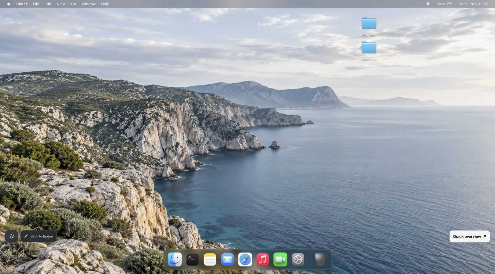
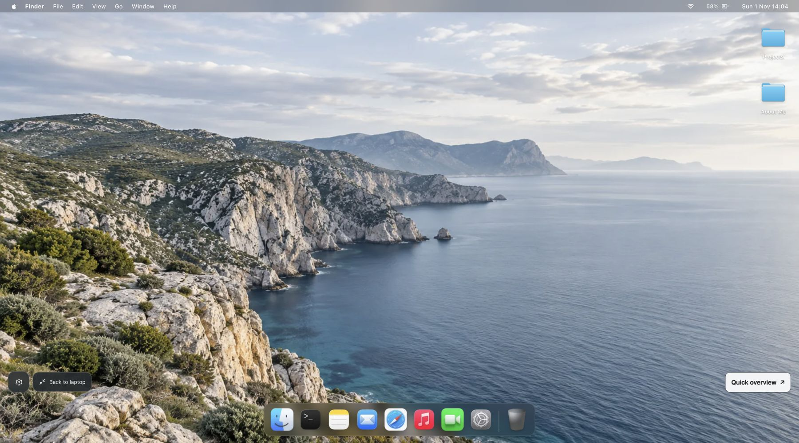
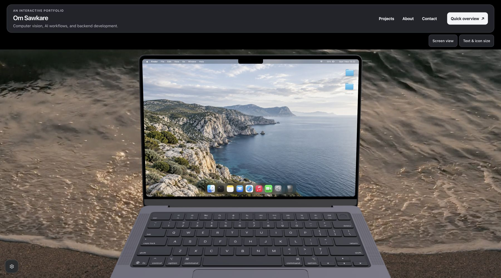
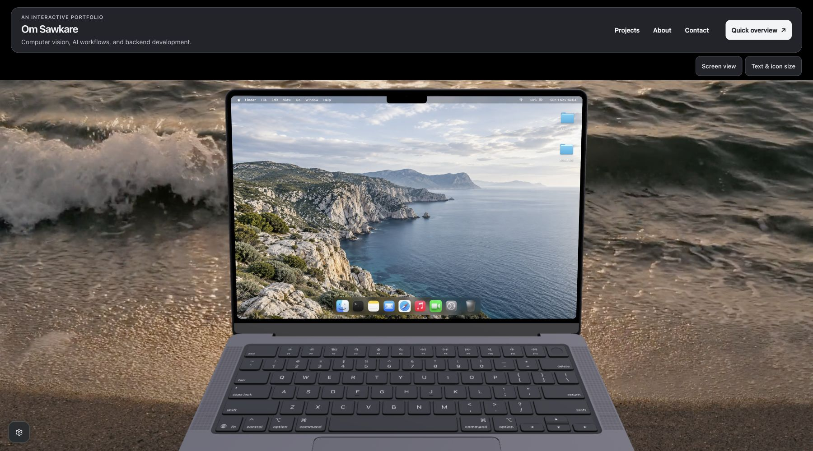
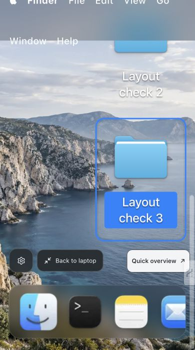
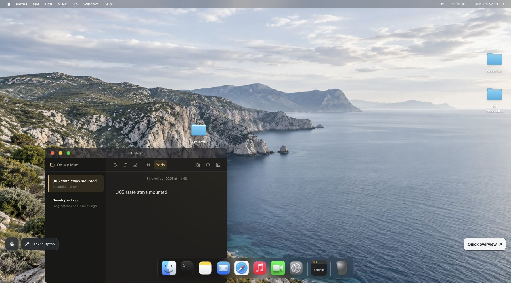

# U05 — Screen geometry and desktop icon anchoring

## Reproduced cause

The system store seeded Projects and About Me with pixel coordinates before the desktop DOM existed. The fallback was a 1400 × 900 desktop. Rendering subsequently treated those defaults as explicit visitor placement, so Screen view retained x = 1300 on an 1800-pixel desktop. The old clamp also reserved a full-width Dock strip and underestimated the actual icon height.

| At 1800 × 1000, default sizes | Before | After |
| --- | --- | --- |
| Projects origin | 1300, 48 | 1700, 48 |
| About Me origin | 1300, 136 | 1700, 172 |
| Right gap, both icons | 416 px | 16 px |
| Measured cell | 84 × 98 | 84 × 116 |

The new height includes room for a two-line label. Full names remain available to assistive technology and in the title tooltip.

## Layout and preference policy

- `desktopPositions` contains only explicit manual placements, keyed by stable file IDs. Creation, initial layout, resizing, theme/readability changes, and switching views do not write default coordinates into it.
- Automatic icons fill down the measured right edge with a 16-local-pixel outer gap, then wrap left. Slots remain reserved for trashed items until permanent removal. Automatic layout avoids manual placements.
- A full desktop continues vertically in a native icon scroller. Focus/new-folder rename scrolls only that region. Extra scrolling room lets the final automatic row clear floating controls; it does not restrict window dragging or manual icon placement.
- Manual requested coordinates remain session-only. A smaller desktop clamps their presentation; returning to a larger desktop restores the requested location. No normalized coordinates or label-based identities are introduced.
- Pointer drops, custom menus, rename error messages, and the view transition use the existing shared planar projection conversion. Rename errors now stay inside the visible desktop bounds.
- Settings → Accessibility has a separate **Default portfolio view** choice. Ordinary view toggles are temporary. Only validated text size, icon size, and default view are saved under the existing readability key. The old temporary `screenView` field is not migrated into an explicit preference.
- A validated prepaint view hint keeps the page shell consistent with the saved choice; the initial Canvas waits for display-preference hydration. The single mounted desktop and existing Html projection root are retained.
- Future tour previews have separate enter/return actions that cannot overwrite the saved default. U05 does not implement a tour.
- Cancelled/reduced-motion zoom transitions clear the temporary pointer shield. Maximize still clears the Dock; manual window movement still reaches the actual screen bottom behind it.

## Actual browser checks

Production Next.js 16.3.1 build `rjd4QLcnFgOMIkTeC7g1v3`, served locally. MacBook Air / Apple M1 / 8 GB, macOS 27.2 (26B123), Chrome 156.0.8078.76. Browser-controlled pointer and keyboard input; no claim of physical trackpad or Windows testing.

| Check | Observed result |
| --- | --- |
| Laptop and Screen, all four text sizes × three icon sizes | All 12 combinations checked in each view. Automatic right gaps 16–16.006 local px (DOM rounding). See size JSON files. |
| Repeated animated laptop/Screen toggles | Default icons reflow; transition shield clears; same note text remains. |
| Manual Projects movement | Pointer drag produced manual origin 658, 422; retained through view changes and resizing. Narrow width clamps it; widening restores the request. |
| Resize | Exercised 1800 × 1000, 1000 × 700, 800 × 600 and 390 × 700. |
| Wrapping and overflow | Real session folders wrap into columns on wider layouts. At 390 × 700 and maximum sizes, new folders scroll into view and can be renamed; native scrolling returns to the beginning. Last focused icon clears the floating controls. |
| Rename and context menus | Generated name selected on creation; Enter commits; Escape cancels; empty name rejected. Secondary-click and Shift+F10 menus fit inside the desktop. Error bubble previously extended to x = 1842; now ends at 1794 in the 1800-wide view. Narrow error/menu also remain within bounds. |
| Window geometry | Notes maximize in Screen view; laptop restore and return to Screen retain the original 274,174 / 642 × 478 rectangle before resizing. Actual pointer drags reach left, right, top and bottom boundaries. Bottom reaches y = 1000 while Dock starts at y = 910. |
| Saved defaults | Explicit Screen default survives reload; explicit laptop default survives reload. Session folders/positions disappear on reload. |
| Reduced motion | Actual Settings toggle exercised; view changes settle without a transition marker. Pure preview/persistence tests also cover temporary tour state. |
| Console | No captured warning/error entries during final check. |

Browser zoom shortcut did not produce a verifiable zoom change in the controlled tab. Zoom/DPR behavior is covered by projection and coordinate fixtures, not claimed as an actual browser zoom run. Still check native Safari/Chrome at 85%, 100% and 125%: toggle views, drag/rename the rightmost folder, and confirm the desktop stays aligned. Native Safari, Windows, physical trackpad and live camera/Music continuity were not exercised in U05. A new test note was used; the approved Developer Log was untouched.

## Checks

- `node --test tests/*.test.mjs`: **295 passed**, no failures.
- `npm run lint`: passed.
- `npx tsc --noEmit`: passed.
- `npm run build`: passed, including installed MediaPipe asset consistency check.
- `git diff --check`: passed.

Focused regressions cover automatic/manual layout separation, all size combinations, wrapping/overflow, clamping without overwriting requests, actual bottom-edge reach, identity-preserving folder history, pointer conversion, visible popover bounds, preference validation, prepaint hint consistency, and tour/default separation. Projection fixtures are labelled as fixtures, not hardware evidence.

## Matching views

Each comparison uses 1800 × 1000, dark theme, default interface/icon sizes. Beach video frames naturally differ.

### Screen before

### Screen after

### Laptop before

### Laptop after

### Narrow overflow after

### Window behind the Dock

No commits, pushes, deployment, or later U-stage work were performed. Prior uncommitted work is preserved.
