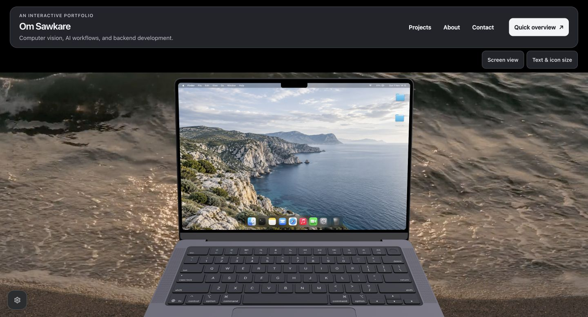
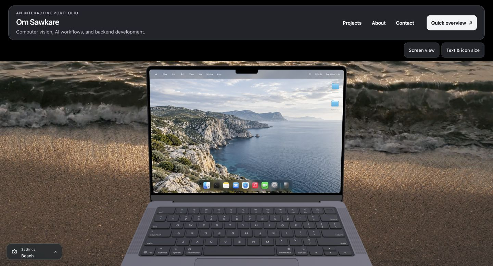
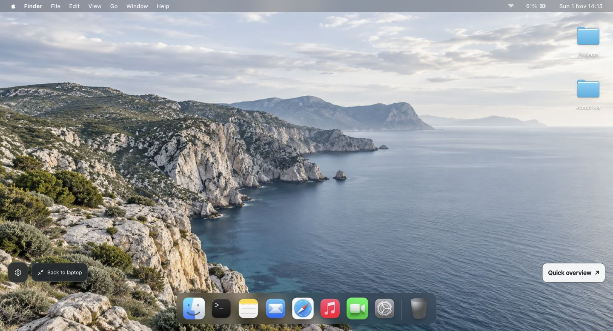
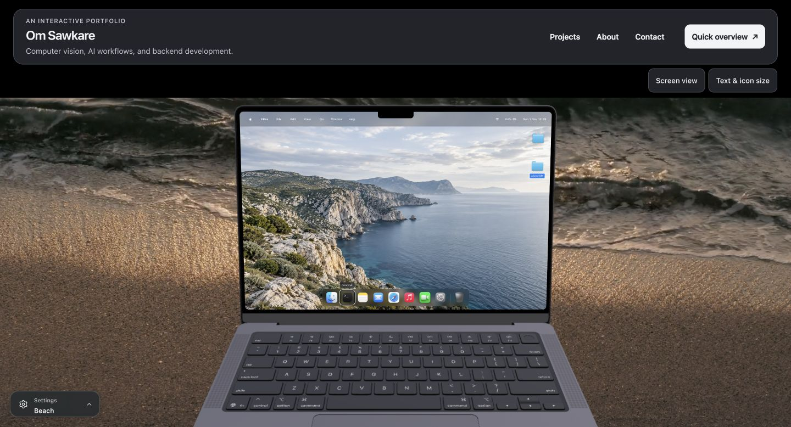
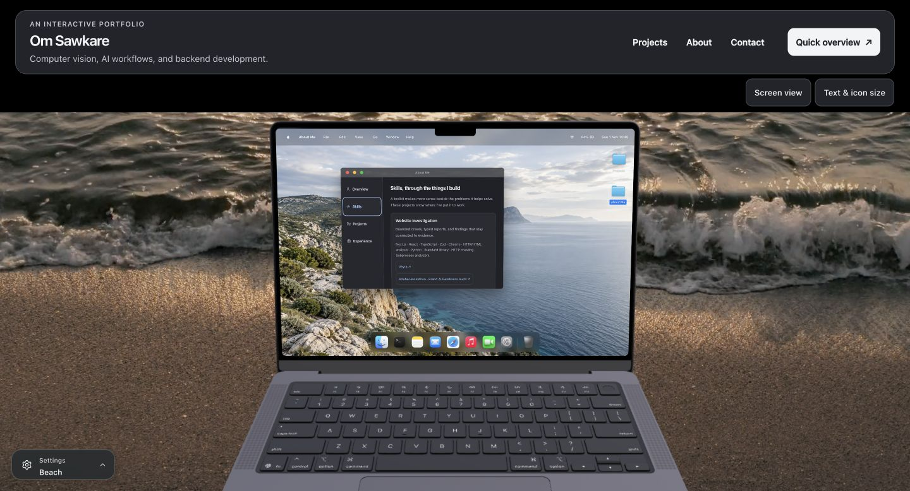
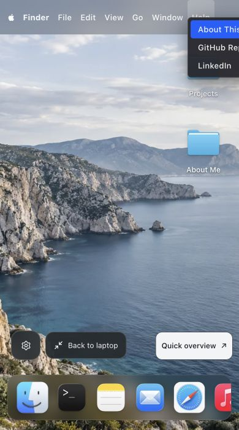
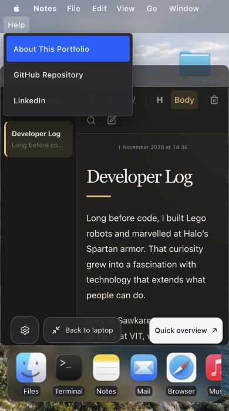
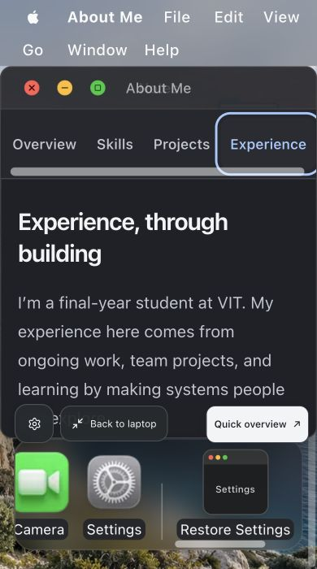
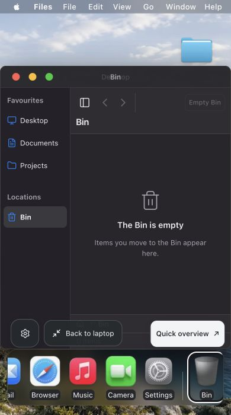

# U06 — Everyday keyboard and touch access

## Baseline and changes

The live Dock exposed nine `div` launchers with no role, accessible name, or tab stop. Its labels appeared only on hover. Minimized entries had the same problem. About already used native section buttons and `aria-current`; the application menus already supported arrows, Home/End, typeahead and Escape, so those systems were retained.

A real 390 × 700 Screen-view check also reproduced a clipped Help menu: its right edge was x = 526 on a 390-pixel desktop.

- Dock launchers, minimized entries and Bin now use named native buttons. Enter/Space rely on the browser's single activation path, with no additional keyboard-click handler. Icon images are decorative inside the named controls.
- Current Dock application state is exposed with `aria-current`. Minimized entries say **Restore [title] window**, retain their stable IDs and ordering, and use the existing activation action rather than toggling a window back into minimization.
- Launch/restore focus goes into the existing app surface. Minimizing from a window control or the Window menu focuses its matching Dock entry. A restored Files/Bin window can retain its own folder-area focus. Queued focus ignores inactive, minimized and closing window surfaces.
- Dock focus has a light/dark focus ring and reveals the label. Narrow and coarse-pointer layouts keep short labels visible without hovering. The Dock scrolls its own horizontal region to reveal a focused launcher, without scrolling the projected host.
- Icon artwork, app order, pointer magnification, Bin drop target, window stacking and app lifecycles remain in place. Reduced motion disables Dock magnification/lift; there are no new players, renderers or camera requests.
- Menus now use the shared desktop coordinate conversion and visible bounds. They wrap safely with the measured desktop and reveal keyboard-focused items inside their own scroller. Escape returns to the trigger; Tab dismisses and continues navigation; outside clicks dismiss without redirecting focus. Modified Escape is left to the browser/OS.
- About keeps its existing navigation/content, adds a named content region, and retains its current-section state. Its existing app-width container layouts remain responsible for narrow-window navigation.
- Larger local hit areas in laptop view compensate for the projection without changing icon artwork or typography. Screen view retains the compact menu and ordinary control sizing; coarse-pointer menus have taller rows. The measured menu height continues to feed desktop/window bounds.
- Visible Dock/app-menu names are Files, Browser, Camera and Music; internal kinds and launch IDs remain `finder`, `safari`, `facetime` and `music`.

No window-manager or filesystem redesign, content rewrite, preference migration, or persistence change was introduced.

## Actual checks

Production build on Apple M1 / 8 GB MacBook Air, macOS 27.2, Chrome 156.0.8078.76. Browser-controlled keyboard and pointer input. Main comparison viewport: **1440 × 778**. Narrow Screen view: **390 × 700**, including 145% text/interface scale. Light and dark themes and the app's Reduce Motion setting were exercised.

| Check | Result |
| --- | --- |
| Keyboard-only route | Tab from page body → Dock Files → Enter launch → Tab to About Me → Space open → Tab to Skills → Space switch → Shift+Tab back to menu bar → End/Left/Down to Window menu → Escape and reopen → Enter minimize → Space restore → Tab to Dock Bin → Enter open. No mouse was needed for this route. |
| Single activation | Enter and Space launch/restore once. Repeated Notes launcher activation retains one `app-notes` window. Restore clears minimization, activates the existing window and removes its minimized Dock entry. |
| Menu movement and dismissal | Arrows, Home/End, Escape focus return, Tab dismissal and outside clicks exercised. Final narrow Help menu fits at x = 6…226; all actions remain within the desktop. |
| Projected targets, settled 1440 × 778 laptop | Dock target grew from approximately 22 × 22 to 25 × 25 rendered px; About navigation height from 17.9 to 25.9 px. Menu trigger measured 26.7 × 26.5 px. See `target-measurements.json`. These are local DOM measurements, not accessibility certification. |
| Narrow Dock | Keyboard focus reveals Bin through horizontal scrolling. Label remains visible (`opacity: 1`); Bin target measured 56 × 77 px. No second tap/hover is needed to activate an exposed launcher. |
| Narrow About and large text | Experience becomes current, horizontal navigation reveals it, and the selected control remains within the app frame. At 145% its target height is 63.8 px. Wrapped menu bar measures 81.2 px and the window clears it. |
| Folder editing | New Folder enters selected-name editing; Enter commits. Shift+F10 → Rename selects the existing name. Escape cancels. |
| Drag/drop | A disposable folder was pointer-dragged into the native Bin button, appeared in Bin under the same ID, and was restored with Enter. |
| Editor ownership | Typed into a new disposable note. Native keyboard Undo and Edit-menu Undo remove note text; the created folder remains. The approved Developer Log was not edited. |
| Themes/motion | Focus and selected states inspected in both themes. Reduced motion exercised alongside large-text/narrow navigation and minimize/restore. |
| Console | No captured warnings/errors in the final focused browser check. |

The three new Node regressions cover native Dock semantics and names, action dispatch/restoration, scoped/stale focus handling and menu-only scrolling. Existing store/geometry/identity/editor tests remain in the full suite.

## Checks and limits

- **298/298** Node regression tests passed.
- Lint, TypeScript checks, production build and `git diff --check` passed.
- Build includes the existing MediaPipe asset compatibility check.
- No commits, pushes, deployments or later U stages.

This was not a physical touchscreen, trackpad, Windows, native Safari or screen-reader hardware test. Single pointer activation and always-visible narrow labels were exercised; coarse-pointer CSS was implemented/inspected, not falsely reported as a real touch run. Native browser/OS shortcut combinations beyond editor Undo were not physically verified; shortcut ownership is additionally covered by the existing focused tests.

On a much smaller laptop projection, or during its entrance, rendered controls can still be smaller than the settled measurements above. Screen view and text-size controls remain available for a readable full-page experience. No claim of universal target sizing or accessibility certification is made.

Remaining hardware checklist: repeat the keyboard route with Safari keyboard navigation enabled; use a Windows mouse/trackpad for right-click and restore; on a touchscreen verify one tap per launcher, horizontal Dock scrolling, visible labels, and About navigation at narrow widths. Confirm native browser and OS shortcuts retain ownership.

## Views

Comparisons use the same 1440 × 778 viewport and default sizes. Live beach video frames naturally differ.

### Laptop before / after

### Screen before / after

### Keyboard focus in the projected view

### Narrow menu before / after

### Narrow navigation at 145%

