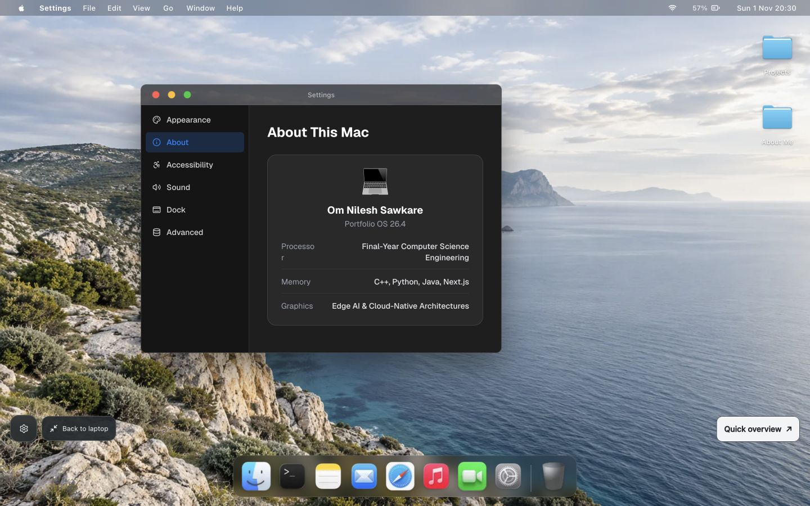
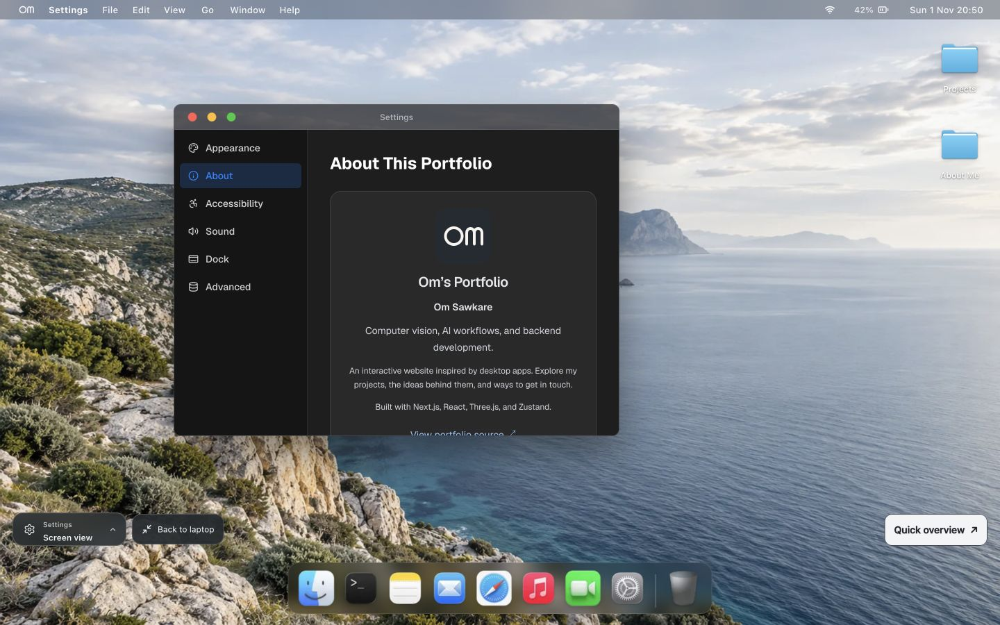
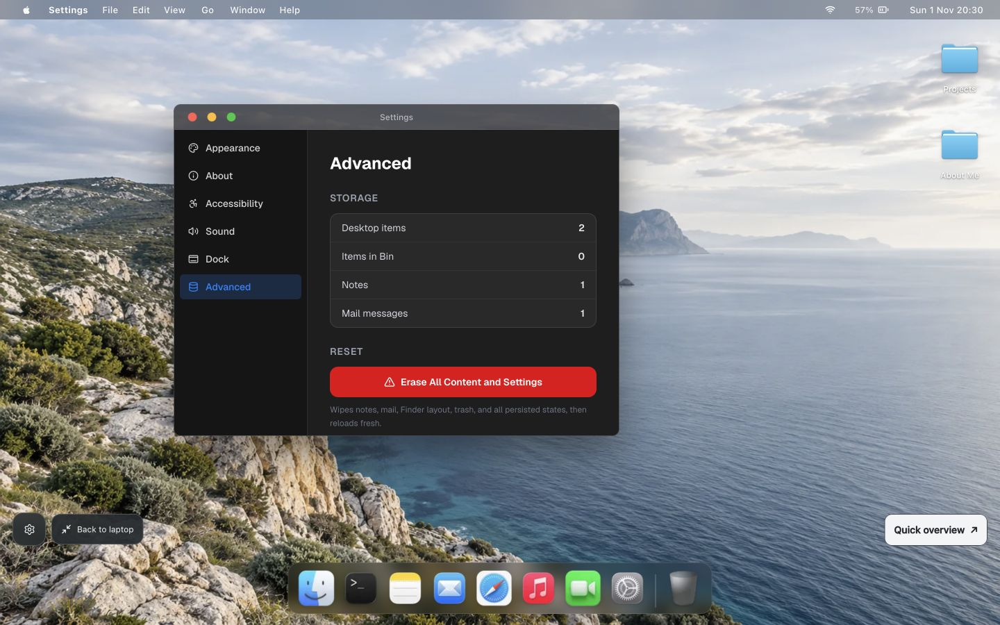
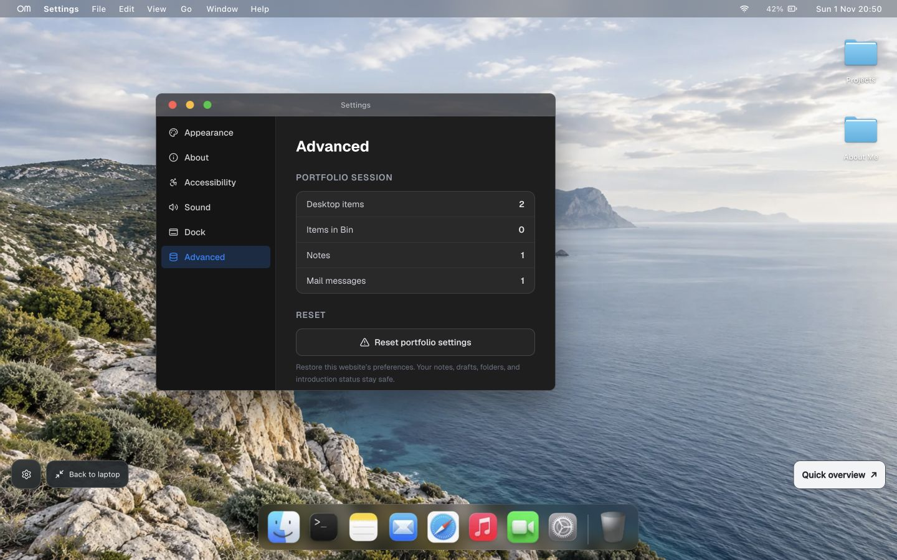
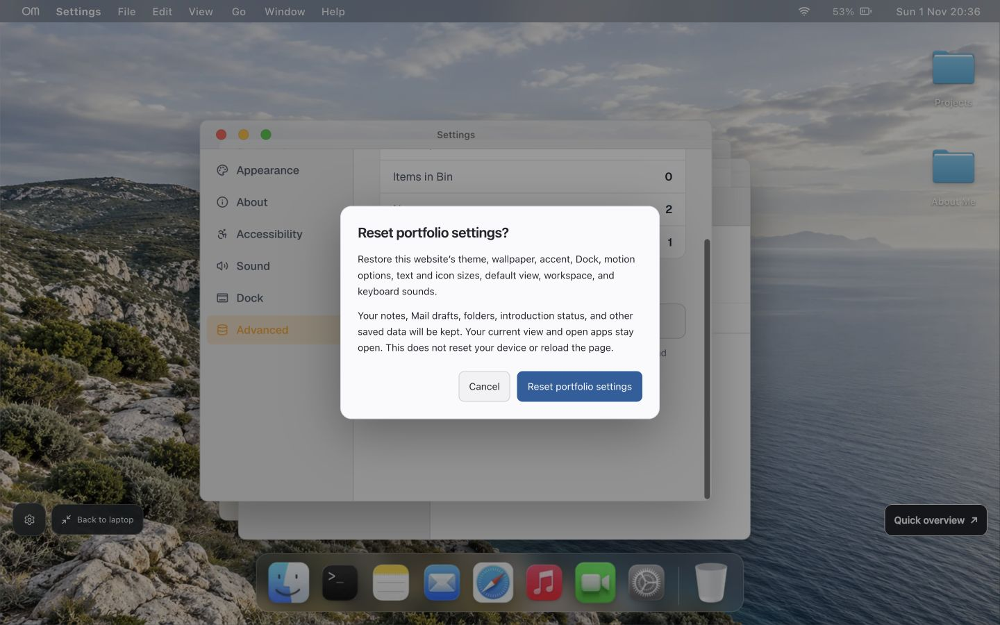
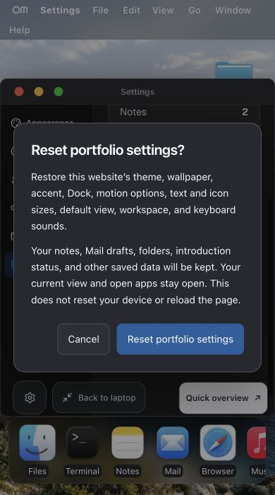
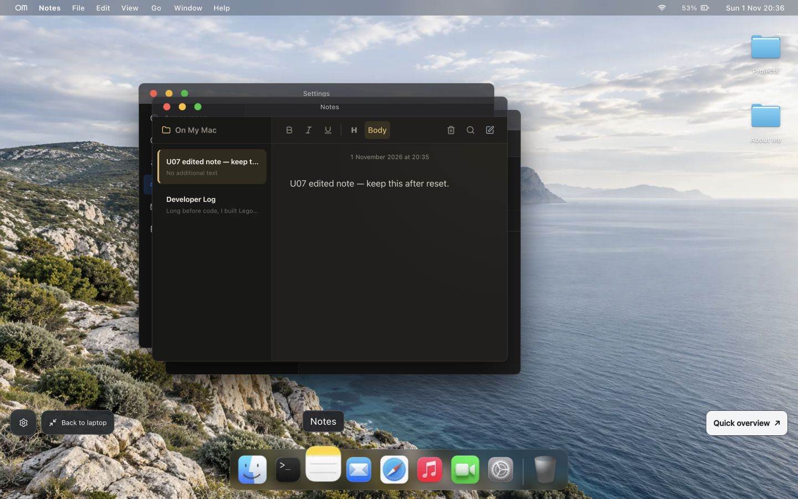
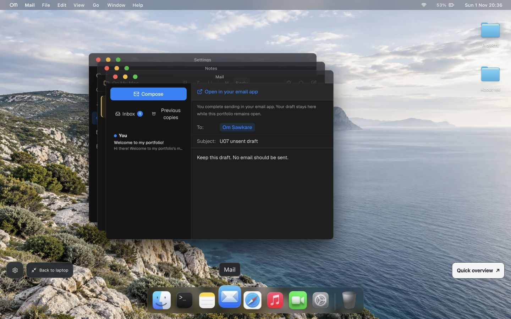
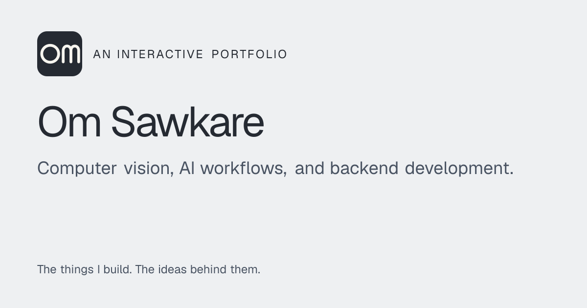

# U07 — Om identity and safe preference reset

## Completed scope

Visitor-facing app names are **Files, Browser, Camera, Music, Notes, Mail, Terminal and Settings**. Internal component filenames, app kinds (`finder`, `safari`, `facetime`, etc.), window IDs, project/file/tab associations, and existing artwork were retained. Old app/About titles resolve through a small display-only compatibility map. A visitor folder or file merely named Finder or Safari is not renamed.

The main menu now uses an original outlined **Om** monogram. Its About route opens Settings → About This Portfolio; Help → About This Portfolio opens the existing portfolio modal. Both reuse the same identity content and source link. Copied app version numbers, “Portfolio OS 26.4,” and hardware-style Processor/Memory/Graphics labels were removed. Unsupported battery APIs no longer display an invented 100% value; the Wi-Fi ornament is decorative rather than an asserted network status.

The approved Notes Developer Log and quote were not modified. Intentional empty folders, Neural Block, projects, media assets and their existing attribution were left intact.

## Metadata and artwork

- Rendered title: **Om Sawkare — Interactive Portfolio**.
- Description: “Explore Om Sawkare’s work in computer vision, AI workflows, and backend development through an interactive portfolio.”
- Open Graph/Twitter title, description and site identity are Om-specific. Favicon and touch icon use the original Om mark.
- Om confirmed that the site is **local-only**. There is no configured public origin. No localhost or invented canonical, `og:url`, or absolute social image URL is emitted. The local share artwork is ready. When a real public origin exists, set `PORTFOLIO_PUBLIC_ORIGIN` and rebuild; the metadata then uses that validated origin. `.env.example` documents this without inventing a domain.
- Source and font permission: [identity provenance](../../public/identity/PROVENANCE.md), including the copied Geist SIL OFL 1.1 license. The monogram geometry and share-card composition are original work for this portfolio. Existing icon/media notices remain applicable; renaming is not a legal-clearance claim.

| Asset | Size | Result |
| --- | ---: | --- |
| `src/app/icon.svg` | 361 bytes | Original vector Om mark |
| `src/app/favicon.ico` | 2,678 bytes | 16/32/48 px entries |
| `src/app/apple-icon.png` | 5,086 bytes | 180 × 180 PNG |
| `public/identity/share.png` | 51,997 bytes | 1200 × 630 PNG |

All four assets returned HTTP 200 with appropriate image types. See `server-metadata.json`. The browser inspection extension substitutes its own favicon badge; the original server links and image responses were checked separately. `rendered-metadata.json` records the actual DOM title and social metadata without retaining that injected badge data.

## Reset contract

The action is now **Reset portfolio settings**, with a readable native modal explaining its exact scope. Cancel is initially focused. Cancel/Escape dismiss and return focus; they do not leave Screen view or change preferences. Confirmation does not reload the page.

Exactly four owned keys are removed:

1. `portfolio-appearance`
2. `portfolio-readability`
3. `portfolio-workspace`
4. `portfolio-keyboard-sounds`

In-memory appearance, accent, Dock/motion options, sizes, future default view, workspace and keyboard-sound preferences return to their existing defaults. The current view and temporary preview state remain; the next-visit default becomes laptop view. Workspace reset uses the existing transition coordinator. A retiring transition cannot re-save the pre-reset scenery, and a later explicit visitor selection remains authoritative.

There is no origin-wide clear, prefix deletion, content-store replacement or reload. Notes, drafts, mail copies, folders, drag positions, filesystem history and open window state are preserved. All non-allowlisted storage is untouched, including introduction status. The current implementation has no completed/skipped tour store yet; those statuses were tested as explicit storage fixtures, not falsely described as an existing live onboarding feature. Restricted storage produces truthful partial-success feedback while applying this visit’s defaults.

Keyboard sounds reset to the requested enabled preference and still rely on trusted typing. Reset does not start Music or request a camera.

## Actual verification

Production build; Apple M1 MacBook Air / 8 GB; macOS 27.2 (26B123); Chrome 156.0.8078.76. Desktop comparisons use **1440 × 900**. The confirmation was also checked at **390 × 700**. No claim of native Safari, Windows, physical touch, camera hardware or social-crawler testing.

| Check | Evidence |
| --- | --- |
| Cancel | Prepared light/orange appearance, 115% interface size, Sage workspace, keyboard sounds off, an edited disposable note, and an unsent Mail draft. Before/after Cancel snapshots are identical. |
| Escape | Dialog closes, focus returns to Reset portfolio settings, and Screen view stays active. |
| Confirm | Theme dark, size 100%, workspace Beach, keyboard sounds enabled. Same note, draft fields and three open app IDs remain; current Screen view stays active. No reload. See `reset-preservation.json`. |
| Protected storage | Real reset/store tests preserve unrelated key bytes, mail-store data, prefix-neighbor keys, and both completed/skipped introduction fixtures. Filesystem objects/history/manual positions and window records remain the same references in the focused store checks. |
| Narrow confirmation | Dialog fits at x = 19…371 in a 390-pixel viewport, with visible controls and initial Cancel focus; no clipped content. |
| Launchers | Files → `finder-desktop`, Browser → `app-safari`, Camera → `app-facetime`, Music → `app-music`. Browser app About shows Browser-specific portfolio copy and retained artwork. |
| Both About routes | Settings card and portfolio modal show Om’s identity and a working repository href, with no copied hardware/version claims. |
| Metadata/artwork | Browser DOM plus original server HTML/asset responses checked. Local-only metadata contains no invented public origin. PNG/ICO dimensions also checked by regression tests. |
| Camera/Music boundary | Camera’s existing permission request remained ungranted/pending, and the Camera window was closed. No live-camera parity claim. Music was paused with no source loaded; no playback was started. |
| Console | No captured warning/error entries in the focused UI check. |

**304/304 regression tests passed**, including six identity/reset checks. Lint, TypeScript, production compilation (including MediaPipe asset check), and `git diff --check` passed. Installed Next.js metadata/icon guidance was read before implementation.

Source search found no remaining built-in old app labels, default metadata, copied OS/app version text, Apple menu glyph, or broad storage-clear call in visitor copy. Remaining matches are stable identifiers/imports, the explicit compatibility map, existing artwork filenames, or comments about real browser/platform behavior. Visitor-authored content is deliberately not mass-renamed.

No commit, push, deployment, U08 work, or project-specific public routing was performed. Prior uncommitted work was preserved.

## Views

### About before / after

### Reset before / after

### Scope and cancel option

### Work preserved after confirmation

### Original share artwork

