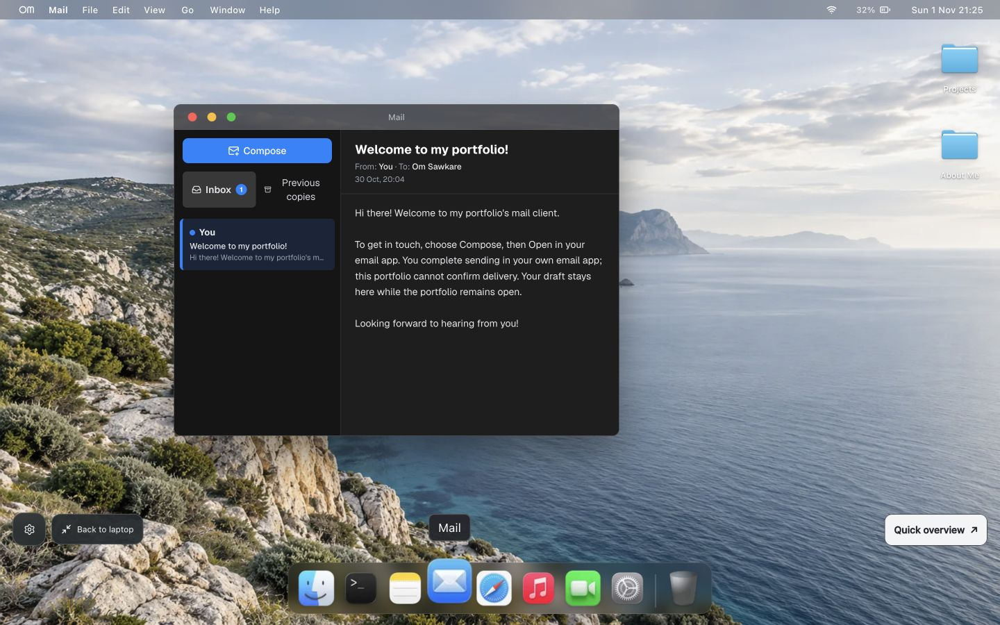
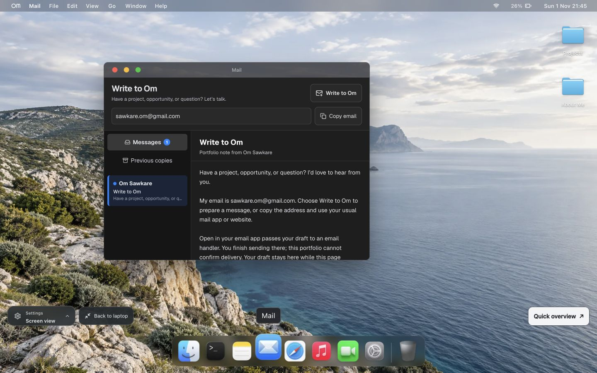
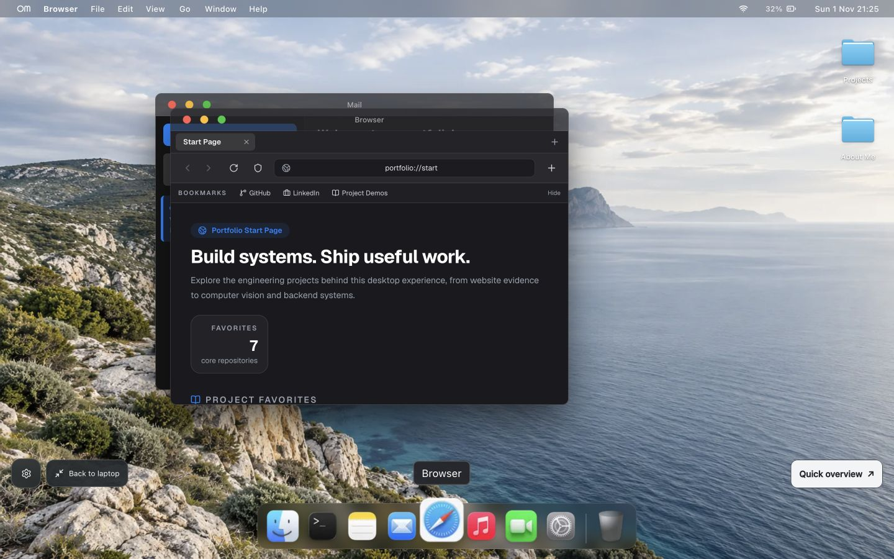
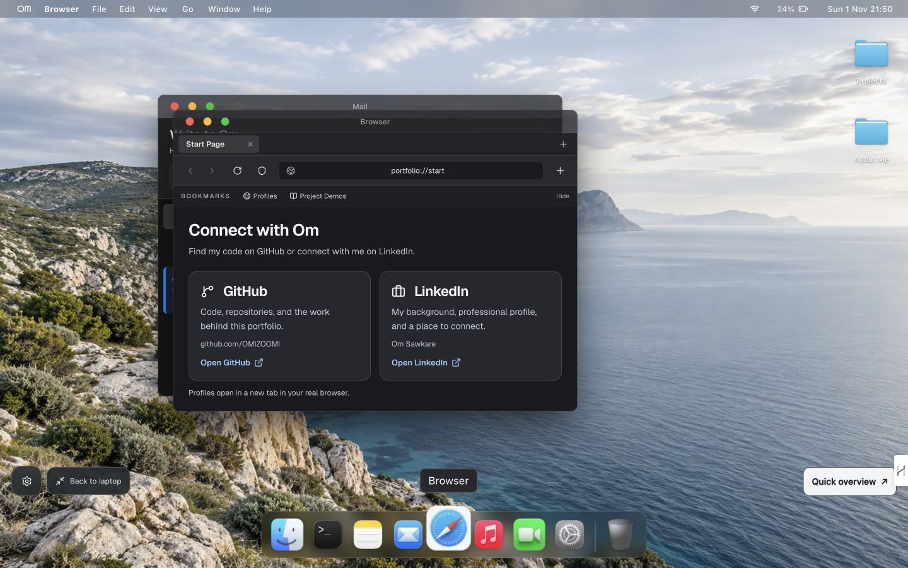
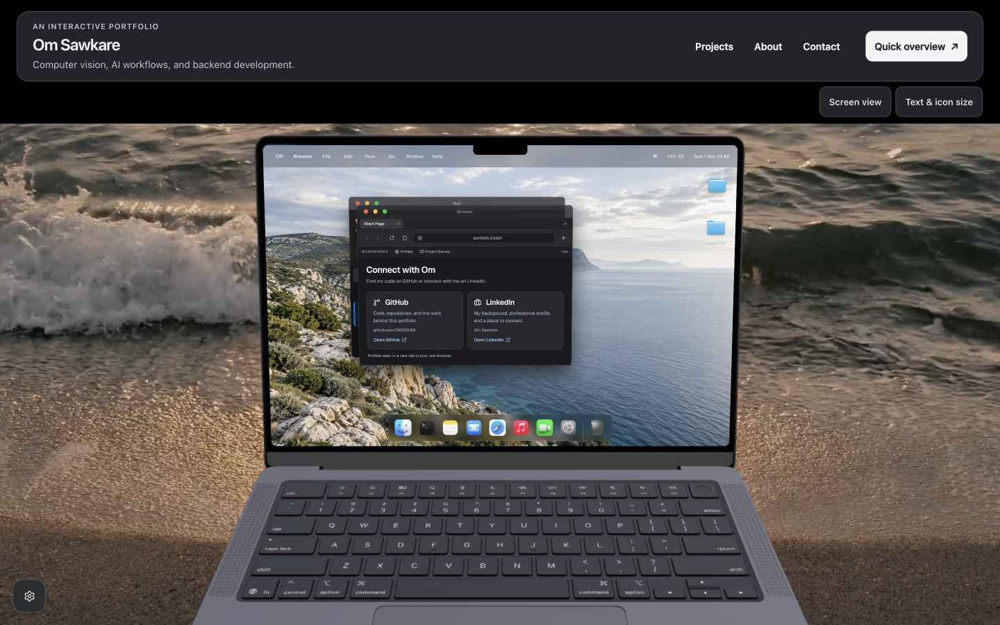
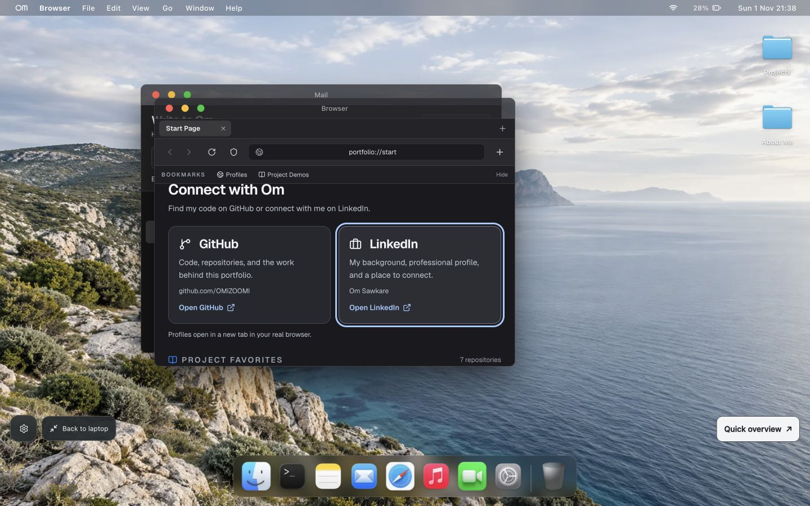
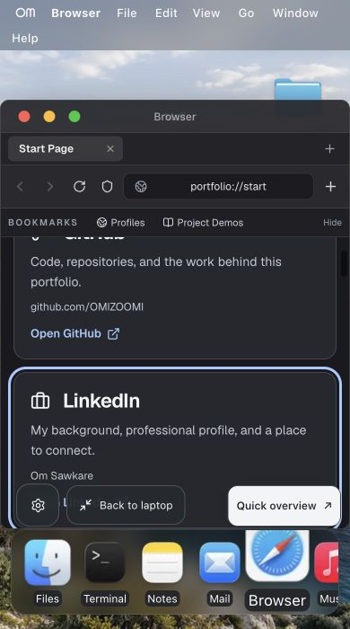
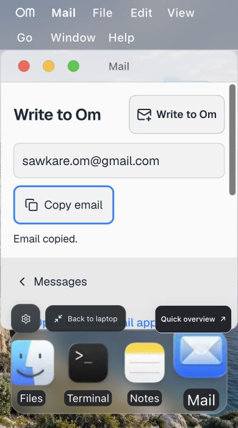
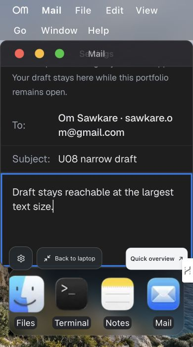
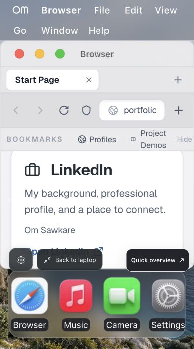

# U08 — Contact and professional profiles

Completed only U08. No backend, commit, push, deployment, or next prompt.

## Baseline and changes

Mail previously hid contact behind Compose and displayed its built-in welcome as a message from “You.” Its existing handoff already kept the draft and did not add a Sent entry. Browser’s start page led with projects; professional profiles were small toolbar buttons.

Mail now opens with **Write to Om**, the selectable address **sawkare.om@gmail.com**, and **Copy email**. The composer uses **Open in your email app**, explains that sending finishes there, and keeps the draft. Its Back to messages action explicitly keeps the draft. Messages and retained previous copies use semantic buttons and visible keyboard focus.

Browser starts with large, quiet **GitHub** and **LinkedIn** cards before project favorites. They are native external links, with new-tab labels and `noopener noreferrer`, rather than simulated navigation. Profiles and project bookmarks still use the existing per-tab navigation. The Browser state/history/private-session implementation was not changed by U08.

Both apps adapt to their own available width. Cards stack in narrow windows. At the largest text setting, Mail uses a compact header and one outer scrolling panel so its contact information cannot consume the entire editing area. Touched feedback respects system reduced motion and the portfolio’s Reduce Motion control. Mailbox hover feedback now settles in 100 ms rather than one second.

## Shared identity and data preservation

All contact destinations resolve from `src/data/portfolioProfile.ts`, reusing the approved identity:

- Email: `sawkare.om@gmail.com`
- [GitHub](https://github.com/OMIZOOMI)
- [LinkedIn](https://www.linkedin.com/in/om-sawkare)

The mail-store version is now 5. Migration changes only the exact old built-in welcome signature, keeping `welcome-1`, timestamps, read state and extra fields. A new welcome is labelled “Portfolio note from Om Sawkare” rather than pretending to be received correspondence. Edited welcomes, visitor messages and all legacy unverified copies remain intact. No app-mount reseeding was introduced.

The existing storage policy remains: inbox and legacy copies are persisted; drafts and handoff feedback stay in memory. Drafts survive switching panes, minimizing, closing and reopening Mail while the page is open. A page reload ends that memory-only draft session; this stage does not silently start storing visitors’ writing. Normal Browser tabs remain memory-only too. Private demo tabs are separate and are discarded on leaving Private or closing Browser; external destinations open in the visitor’s ordinary real browser.

Clipboard success is reported only after `writeText` resolves. Missing, blocked or inaccessible clipboard APIs offer manual selection, focus/select the visible address and make no success claim. A `mailto:` request cannot reliably reveal whether an email handler exists, opened or sent anything. The UI therefore reports only the request, keeps the draft, and offers copy/manual-email guidance if nothing happens. No Sent entry is created and no email was sent during testing.

## Actual verification

Production build; Apple M1 MacBook Air, 8 GB; macOS 27.2 (26B123); Chrome 156.0.8078.76. Comparable desktop screenshots use 1440 × 900 and the same default app sizes. Narrow checks used 390 × 700, default and 145% interface text; the enlarged app’s logical width was 267 px. No claim of physical touch, native Safari, Windows, screen-reader certification or performance improvement.

| Check | Observed result |
| --- | --- |
| Copy email | Click and keyboard Space show “Email copied.” Pasting into the disposable draft produces the exact address. The browser automation’s separate clipboard read did not mirror the OS clipboard; the actual keyboard paste was used as evidence. |
| Manual fallback | Missing API, rejected permission and inaccessible API getters were exercised as controlled unit fixtures. Each returns manual-copy guidance, never success. The real address field remains selectable. |
| Handoff and return | A real local `mailto:` request ran. Returning to the portfolio retained both draft fields, displayed request-only guidance and left Previous copies empty. No delivery/success claim. |
| Native cancellation limitation | The Mac’s native session was locked, so a real email-client cancellation dialog could not be inspected or operated. Null-return/cancellation and thrown-handler paths were separately exercised as fixtures against the actual store; exact draft bytes and legacy-copy references remained unchanged. |
| Draft lifecycle | Back to messages → Write to Om, minimize → keyboard restore, close → keyboard reopen all preserved the disposable subject and body. Reload retained the existing memory-only policy. |
| Legacy data | Regression fixtures verify exact-seed migration, edited/visitor message preservation, stable IDs/metadata and retained unverified copies. No user content was deleted or mass-renamed. |
| External profiles | GitHub keyboard Enter opened a real tab at the exact supplied GitHub URL. LinkedIn click opened a separate real tab at the exact supplied LinkedIn URL. The simulated tab URL stayed unchanged. Test-created external tabs were closed. |
| Keyboard | Native focus moves GitHub → LinkedIn with Tab and a visible outline. Copy email works with Space; launch/restore with Enter. Composer fields and Mail navigation remain reachable. |
| Narrow / enlarged | Profile cards stack with no horizontal overflow. At 145% text, Mail still exposes copy and the editable draft through its own scrolling panel; logical width 267 px, horizontal overflow 0. At 390 px, keyboard focus scrolls the second profile into view. |
| Themes / motion | Both light and dark surfaces inspected. With the portfolio Reduce Motion switch active, profile-card computed transition duration is 0 s. Sizes/theme were returned to their starting defaults after testing. |
| Tabs / histories | Created normal Veyra and Adobe tabs, switched by ID, went Back to Start Page with Forward still enabled, and confirmed the Adobe tab kept its URL. Private began separately with one Start Page; returning restored both normal tabs; re-entering Private started fresh. Reload returned to the existing one-tab normal session policy. |
| Console | No captured warning/error messages in the focused production UI check. |

**310/310 regression tests passed.** Six new contact/profile checks cover migration, clipboard success/failure, mail handoff preservation, storage boundaries and native external-link semantics. Existing Browser, folder, window, media, identity/reset and overview regressions also passed. Lint, TypeScript, production compilation (including installed MediaPipe asset checks), and `git diff --check` passed. No dependencies were added.

Remaining manual checks: cancel a real configured email-client handoff on an unlocked machine; repeat clipboard-denied and unavailable-handler cases in native Safari/Windows; physically check touch activation. The tested implementation provides truthful fallbacks without assuming those platform results.

## Comparable views

### Mail before / after

### Browser before / after

### Projected laptop and keyboard focus

### Narrow windows and largest text

