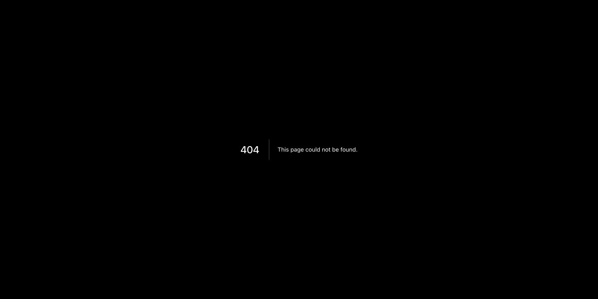
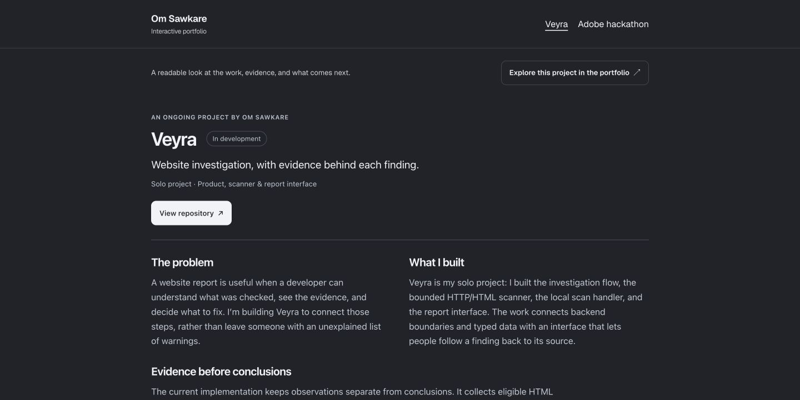
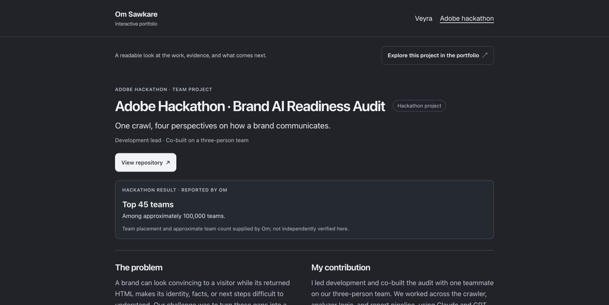
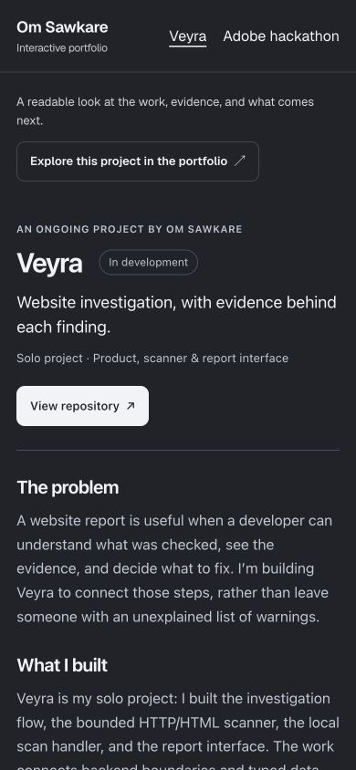
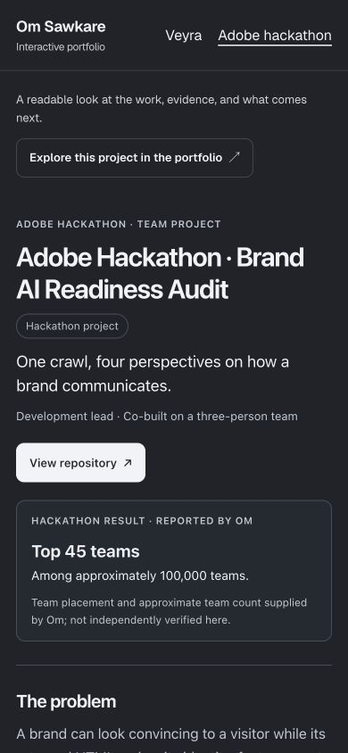
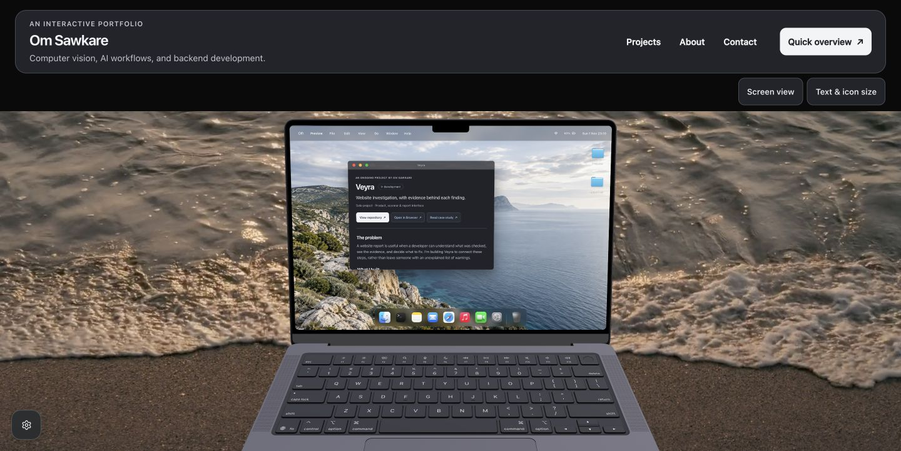
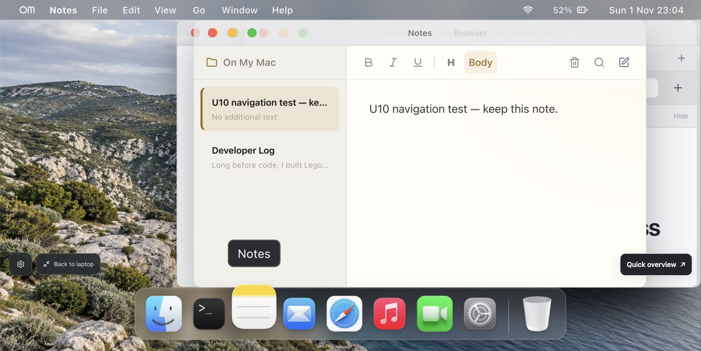
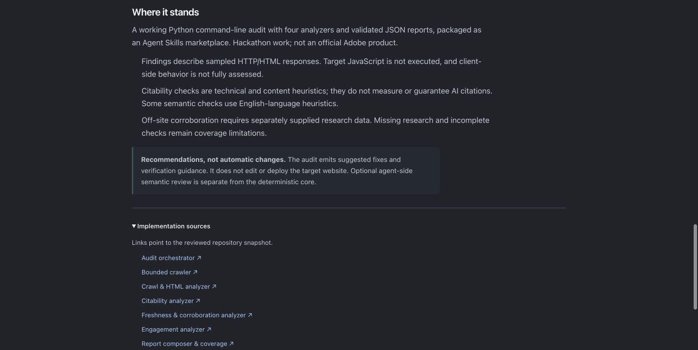
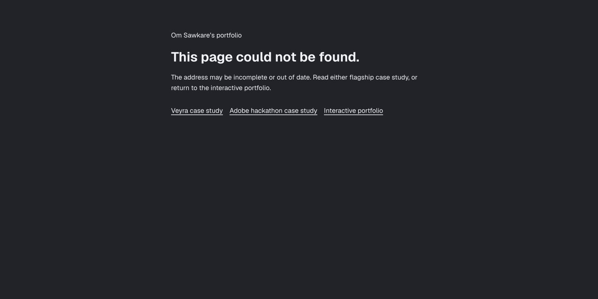

# U10 — Shareable flagship case studies

Implemented U10 only. U09/certificates remain deferred. No commit, push, deployment, dependency upgrade or new content platform.

## Routes and content

| Project | Stable reading path | Interactive entry |
| --- | --- | --- |
| Veyra | `/projects/veyra` | `/?project=veyra` |
| Adobe hackathon | `/projects/adobe-brand-audit` | `/?project=adobe-brand-audit` |

Both reading pages are pre-rendered HTML, reusing the canonical catalogue and the approved U03/U04 case-study renderer, diagrams, evidence links, limitations and attribution. A fresh reading page creates **no desktop, Canvas, camera or Music player**. Its core content also works when application JavaScript files are blocked. Native source disclosures and ordinary links remain usable.

The two `publicSlug` fields are additive. Existing file/window IDs, catalogue keys, aliases and simulator addresses are unchanged. Public slugs use an exact allowlist; there is no fuzzy match to another project. Unknown slugs return a genuine **HTTP 404**, readable initial HTML, `noindex`, and links to both case studies and the portfolio. The finite routes use `generateStaticParams` with `dynamicParams = false`. This also avoids an incomplete runtime error document observed while testing an unknown slug.

## Navigation contract

- Opening a file or project **inside** Files, About, the overview or the simulated Browser keeps the real URL unchanged. The simulator’s `portfolio://` addresses are not share links.
- **Read case study** is an ordinary anchor with a real `/projects/...` href. An unmodified click uses the existing Next router. Modifier/middle clicks retain native new-tab behavior. The bridge is necessary because Drei’s projected HTML has a separate React root and cannot consume Next’s router context; a direct Next Link there was reproduced as a full reload and corrected before delivery.
- The public page’s **Explore this project in the portfolio** link enters `/` with a validated stable project ID. It opens the existing project window once the desktop is ready. The query is an entry instruction, not a mirror of whichever app/window is currently focused.
- Real browser **Back/Forward** traverses reading pages and portfolio entries. Simulated Browser **Back/Forward** changes only that simulated tab’s history. Neither subscribes to or copies the other’s history.
- Only explicit link actions write real history. Renders and readiness updates do not push/replace entries. Repeated readiness notifications do not repeat the entry action. Root layout owns one mounted desktop, with no route key on the Canvas or projected HTML root.

The desktop keeps its measured geometry while hidden/inert on reading pages. Its Canvas uses `never` while hidden and returns to the existing `always` loop when visible; the active scene’s entrance/lid/key animations are unchanged. Workspace motion and keyboard audio pause. Camera receives the existing inactive-window signal, which stops tracks, preview and inference through its existing cleanup path; returning reconciles the existing owner and respects its camera-off state. Music keeps its existing player and may continue playing, just as when minimized. Closing Music still stops playback and closing Camera still releases tracks.

## Origin and metadata

Om previously confirmed **local hosting only**. No public origin has been supplied, and none was invented or configured. These paths now work on the local server; external public access still requires deploying the site and setting its actual HTTPS origin in `PORTFOLIO_PUBLIC_ORIGIN`, then rebuilding. `.env.example` explains this.

Each flagship emits its own title, description, Open Graph and Twitter metadata from the shared catalogue. With a valid configured origin, canonical and Open Graph URLs resolve to the exact public project path. Without one, absolute canonical/share URLs are omitted; localhost is not published as a canonical. The existing original Om share artwork and its provenance remain unchanged. The reserved example origin used in unit tests is explicitly a fixture, not deployment configuration.

Actual local titles:

- `Veyra — Om Sawkare`
- `Adobe Hackathon · Brand AI Readiness Audit — Om Sawkare`

The hard 404 uses Next’s pre-rendered root title (`Om Sawkare — Interactive Portfolio`) plus a clear not-found heading and `noindex`; it does not render another project as a successful result.

## Actual verification

Production build on **Apple M1 MacBook Air / 8 GB**, **macOS 27.2 (26B123)**, **Chrome 156.0.8078.76**. Desktop comparisons: **1440 × 722**. Narrow pages: **390 × 844**, no horizontal overflow. No claim of native Safari, Windows, physical touch, real-camera gesture parity, field INP or performance gains.

| Acceptance check | Result |
| --- | --- |
| Fresh public tabs and reload | Both slugs show the correct case study/title. HTTP 200 and server-rendered evidence/limits; no media elements or desktop. Native modified click from a project window opened Veyra’s real path in a fresh tab while leaving the original entry URL alone. Adobe was also opened in a fresh tab and reloaded. |
| Relevant interactive entry | Veyra and Adobe links open `file-veyra` and `file-adobe-brand-audit` through existing launchers, after readiness. Laptop alignment and Screen view were inspected. |
| Real history | Public Veyra → portfolio/Veyra → public Veyra → public Adobe → portfolio/Adobe; three Back actions returned through Adobe, Veyra, then portfolio/Veyra. Three Forward actions retraced exactly those entries. No duplicate route entries on render. |
| Simulated history | Simulated Veyra → Adobe → Back → Forward changed the simulated address between those projects while the real URL stayed `/?project=adobe-brand-audit`. Existing tab/private-session regressions also pass. |
| Notes and windows | The disposable note `U10 navigation test — keep this note.` stayed exact across every route. The same Notes/Music/Camera/Browser IDs remained; entering Adobe added only its stable project window. |
| Single owners | Test-only observation proxy recorded **one desktop mount, one renderer mount and one audio element** throughout route changes and all real Back/Forward actions. Music’s actual playback time progressed from **18.42 s → 50.23 s on the public page → 121.35 s** after navigation. Playback was muted through the UI for this check. |
| Camera visibility/cleanup | A clearly synthetic changing-shapes video fixture used no physical camera/microphone or recordings. Active tracks: **1 on desktop → 0 on reading pages → 1 on return**. Inference status changed `ready → paused → ready`. Four sequential acquisitions after returns never left more than one live track. Closing Camera and Music ended with **0 live tracks / 0 playing audio**, still only one desktop/renderer mount. |
| Unavailable WebGL | Fixture blocked WebGL contexts. Both reading pages and project metadata remained available. Entering Veyra showed the existing actionable WebGL error; Open flat desktop opened Veyra with one desktop and zero Canvas elements. Real Back returned to the readable page. |
| Application JS blocked | A separate fixture returned 503 for application JS files. Adobe’s HTML, title, repository/evidence links and native Implementation sources disclosure remained usable. This is application-script blocking, not a claim that every inline browser script was disabled. |
| Unknown slug | `/projects/not-a-project`: HTTP 404, noindex, useful links, zero desktop/media elements. See `http-results.json`. |
| Narrow and keyboard | Both pages fit 390 px with zero horizontal overflow. Native Page Down scrolled the Adobe reading area. Links have visible focus and comfortable targets; the source disclosure works without app hydration. |

Detailed observations: [HTTP results](http-results.json), [route/resource counts](route-resources.json). The resource proxy, synthetic camera and blocked-asset modes are **test-only** in `tests/public-project-fixtures.mjs`; production does not read fixture flags or expose test controls.

**317/317 regression tests passed**, including public path/alias compatibility, page HTML, metadata/origin validation, router registration cleanup, one-shot entry intent, route visibility and Camera pause/resume wiring. Lint, TypeScript, production build (including installed MediaPipe asset checks), and `git diff --check` passed. Applicable installed Next routing, layout, dynamic parameter, metadata and not-found guidance was read before implementation.

Outstanding external checks: configure/deploy at Om’s real public origin when available, then verify public social previews/crawlers; repeat on native Safari/Windows and physical camera hardware. No public deployment or hardware parity is claimed by these local tests.

## Views

### Missing public route before / readable page after

### Narrow reading pages

### Existing portfolio and state preservation

### Failure-independent content

