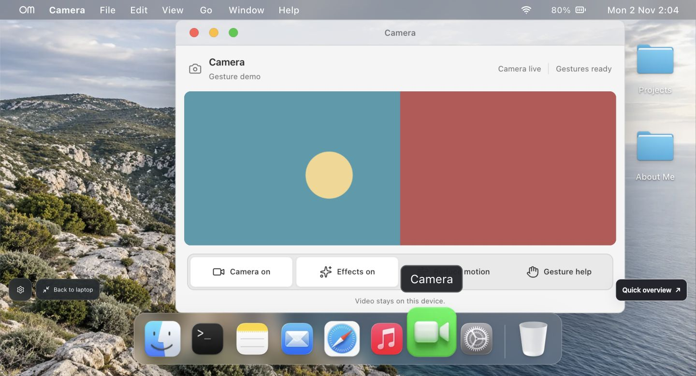
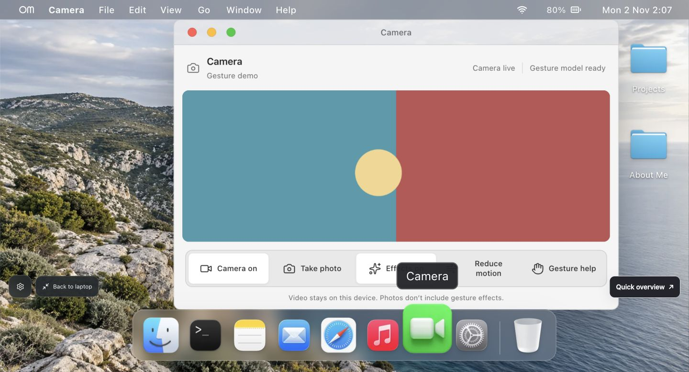
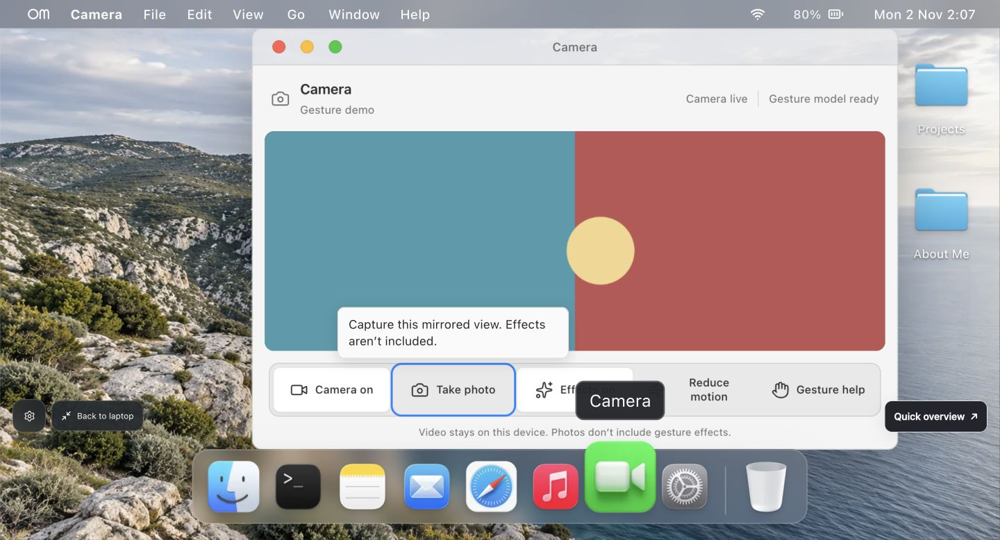
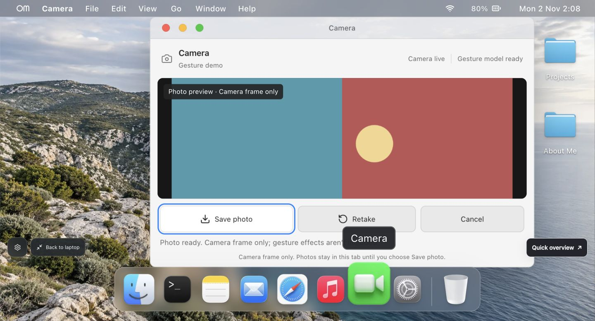

# U11 — Camera controls and local photos

Implemented U11 only. No dependency upgrades, new stream, renderer, inference loop, upload, microphone access, persistence, commit, push or deployment.

## Behavior and lifecycle

- Existing Camera, Effects, Reduce motion and Gesture help controls now have concise hover/focus tooltips. Take photo has a visible label, keyboard focus and a tooltip. Escape dismisses the focused tooltip; native buttons remain usable without hover. Camera and gesture-model/inference statuses remain separate. Gesture feedback is visual rather than a repeated live announcement.
- Take photo is enabled after a successful live preview paint. Capture additionally rejects paused/ended/muted tracks, changed sources, cleared/resized canvases and stale frames. The PNG snapshots the **existing mirrored preview canvas**, including its cover crop. Gesture/CSS effects are deliberately excluded and the interface says so. The existing video remains mounted and live during capture/review.
- Review offers Save photo, Retake and Cancel. Focus moves to Save when ready and returns to Take photo on dismissal. Escape also cancels review. Saving uses a native download link; the message says **Download requested**, not that the file was saved. An explicit Open photo in a new tab fallback is offered after a request.
- One memory-only PNG is retained, at the existing preview resolution (maximum 960 × 540, encoded limit 4 MiB). Encoding has a 5-second timeout. Retake, Cancel, close/unmount and pagehide revoke its object URL. Pending encoding is cancelled on minimize, hidden state or source changes; late/duplicate callbacks cannot create another URL or replace a newer capture.
- A completed photo intentionally survives minimize/tab visibility changes so native download/new-tab handoffs can use it. Only this one bounded photo remains; the established camera lifecycle still stops tracks/inference while unavailable. There is no automatic disk save or upload. Preview decode/encoding failures leave an actionable retry state.

## Verification actually completed

Production build, macOS **27.2 (26B123)**, Apple M1 MacBook Air / 8 GB, Chrome **156.0.8078.76**. Before/after screenshots use **1440 × 778**, Screen view. These tests used an asymmetric, moving **synthetic video source**, never a physical camera or microphone.

| Check | Observed result |
| --- | --- |
| Exact crop and mirror | Both tested PNG captures matched the preview bitmap **pixel for pixel**. Synthetic source-right cyan appeared on the left and source-left red on the right, matching the visible mirrored preview. |
| Live motion and ownership | One acquisition, one live synthetic track and zero audio requests across capture, save, retake and cancel. Source time continued advancing. No extra production capture context or inference owner was introduced. |
| Native save | Chrome created a valid **924 × 327 PNG, 8,938 bytes**, decoded independently from the downloaded file. A copy is included as `saved-synthetic-photo.png`. The browser download-monitoring tool timed out despite the successful native download; it is not evidence that blocked-download handling passed. |
| Retake and Cancel | Two created photo URLs were both revoked; retained URL count returned to **0**. Camera remained live with the same acquisition. See `browser-results.json`. |
| Keyboard tooltip/capture | Tab focused Take photo, its tooltip became visible, Escape dismissed it, and Enter captured once. Save received focus; Retake returned focus to Take photo. |
| Controller regressions | Fresh/live-frame guards, source/permission changes during encode, cancellation, stale/double callbacks, preview decode failure, excessive/null/throwing output, URL failure and timeout all pass. |
| Lifecycle wiring | Controlled effect tests cover pending cancellation on minimize/source change/hidden, bounded ready-photo retention, and photo/listener cleanup on close/unmount/pagehide. Existing camera, gesture, scheduler and effect regressions remain passing. These are fixtures, not hardware tests. |

The download-monitoring tool stalled for roughly five hours, leaving the synthetic source running. The recorded source times reflect that tool stall; this was **not** a planned endurance or performance benchmark. Final browser access to the local fixture origin was declined, so no further browser observations were attempted. The known synthetic test tab was closed and temporary test servers were stopped.

**325/325 regression tests passed**, plus lint, TypeScript, installed MediaPipe asset compatibility checks, production compilation and `git diff --check`. No performance improvement, real-camera compatibility or accessibility certification is claimed.

## Remaining manual checks

On real macOS Safari/Chrome and Windows Chrome/Edge, allow the camera, move continuously, capture, Save/Retake/Cancel, and verify motion and mirror/crop before/after. Repeat with gesture effects (saved PNG must exclude them), minimize/restore, close/reopen and page hide/restore. During pending capture, minimize/close and confirm no late review appears. Deny/revoke permission and retry; Take photo must stay unavailable without a valid frame. In a browser that blocks downloads, verify the request-only message and Open photo fallback. Resize the app narrowly/short, test larger text, keyboard and physical touch, and confirm controls stay reachable. These browser cases remain outstanding; test-only fixture modes exist for denial, encoding error, blocked download and delayed encoding in `tests/camera-photo-fixtures.mjs`, but those modes were **not exercised in the browser** before access was declined.

## Comparable views

Before:

After:

Keyboard tooltip:

Local review (synthetic input):

