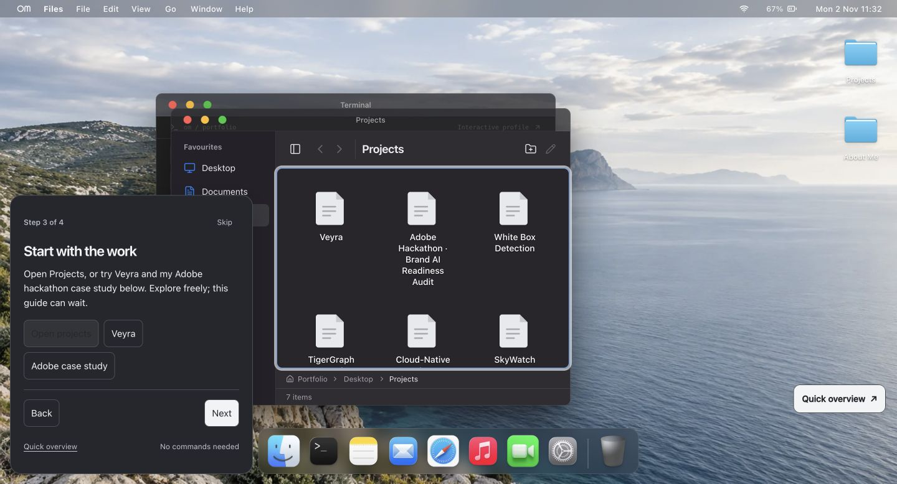
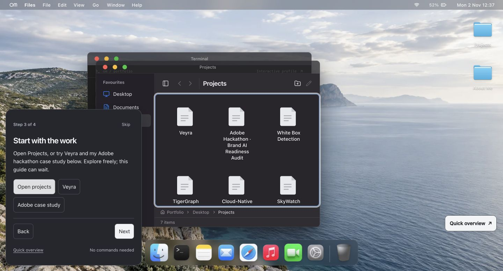

# U13 — Production visitor journey audit

**Verdict: the tested Chrome journey works, with two reproduced tour regressions fixed. Complete performance/cross-platform sign-off remains INCONCLUSIVE.** No renderer, worker, state architecture, content or dependency rewrite was made. Nothing was committed, pushed or deployed.

## Conditions and coverage

Apple M1 MacBook Air (`MacBookAir10,1`), 8 GB RAM, **macOS 27.2 (26B123)**. Actual browser: **Chrome 156.0.8078.76**. Safari **27.2** is installed but was not exercised; Windows/Edge hardware was unavailable.

Production: Next **16.3.1**, React **19.2.8**, MediaPipe **1.0.1**, built and served with `next start` at `127.0.0.1:3012`; existing LAN preview remains on port 3013. Public deployment/origin is still unconfigured. See [HTTP/build identity](http-results.json).

Browser views: **1440×778, DPR 2** initially; native reset also produced **1440×722, DPR 2**. Responsive overrides used **390×844, DPR 1** and matching **1440×778, DPR 1** comparisons. Visual viewport scale was 1; **browser zoom percentage and deliberate zoom changes were not independently verified**. This was loopback HTTP, unthrottled, with existing browser cache retained. It was not a clean-cache/WAN run.

The session began **2026-11-02 05:52:59 UTC** and included long permission, browser-tool and lock-screen interruptions. This is an interrupted audit window, **not a continuous soak/performance test**. Final timing is in `environment.json`.

## Compact results

| Journey/check | Result and practical limit |
| --- | --- |
| Identify Om without learning the metaphor | **Pass:** name, focus, Projects/About/Contact and Quick overview are in initial HTML. The overview explains both flagships and contact. Loader followed by usable returning Screen view was observed. |
| Veyra / Adobe / evidence | **Pass:** correct separate case studies, contribution/status/limitations and labelled implementation/fixture evidence. Real Back returned to the retained desktop. Direct Veyra load/reload and both narrow reading pages worked with **0 canvases/media**. HTTP checks verify both 200 pages and a genuine useful, noindex **404**. |
| Profiles and contact | **Pass:** cards opened real GitHub/LinkedIn target tabs. This verifies the handoff, not LinkedIn authentication/content availability. Copy reported success. The email-app request retained the exact disposable subject/body and made no delivery claim; the originally empty draft was restored. No message was sent. |
| Tour / skipped / returning | **Pass for replay/completion/welcome Skip/returning:** Terminal recovered after close; both project actions worked; completion removed the guide and retained app identities. Skip returned focus to Quick overview. **Fresh-profile automatic offer and all-stage live skip coverage remain incomplete**; controlled regressions cover those transitions. |
| Display and wallpapers | **Pass for tested states:** six dedicated 320 px thumbnails were complete/ready. Auto selected matching light/dark desktop and previews. Forest → Dunes → Coast settled on Coast, ready. Largest text/icons fit a 390 px viewport (267 logical-pixel app width, zero page horizontal overflow); desktop icons stayed at the right edge. Original dark/Coast-light/default-size preferences were restored. |
| Scroll, windows and focus | **Pass for sampled interactions:** Settings scrolled down then up; this is not physical Safari trackpad validation. Maximize/restore worked; dragging reached screen bottom **722** behind Dock top **632**. Keyboard restore activated Music. Menu Enter/ArrowDown/Escape returned focus to its trigger without leaving Screen view. A complete keyboard-only traversal and physical touch were not performed. |
| Files and Notes | **Pass:** generated folder name selected fully; rename kept its real ID; Undo/Redo and custom secondary-click menu worked; opening the renamed folder and creating a child used the same parent ID. Notes Body was a 16 px paragraph; ordinary text undo, delete and Undo delete worked. Disposable notes/folders were cleaned through their own controls/session reload; approved Developer Log was not edited. |
| Music / route state / reopen | **Pass for smoke checks:** no source/autoplay before Play; actual track metadata **214.441 s**. Music progressed **37.657 → 39.908 → 56.840 s** across the reading page and return, with one audio element and edited Note preserved. Minimized playback continued. Close paused immediately; three reopen cycles each had **one paused element, empty source, time 0**. Next was pressed, but its subsequent track transition was not conclusively sampled. |
| Real Camera on this Mac/Chrome | **Pass for live/capture/minimize smoke:** FaceTime HD Camera, **1280×720**, GPU model ready. Real video advanced **135.526 → 140.152 s** around capture/retake/cancel; temporary PNG preview decoded at **924×416**. No photos were saved/uploaded. Om physically confirmed peace and thumbs-up both produced effects. Minimize reported camera/inference paused and video width/ready state 0; keyboard restore subsequently returned live/ready. |
| Resource/performance integration | **Partial:** no duplicate audio element in the tested cycles; one desktop/renderer at final sampled state, no Camera/Music/guide. **No heap trend, exact active-track count, listener census, inference-loop count, frame-time/long-task distribution or local-latency trace was obtained.** Existing lifecycle regressions remain green; these are not a memory-leak proof. |

Evidence: [route/media state](route-media-check.json), [Music cycles](music-reopen-cycles.json), [folder identity](folder-identity.json), [appearance](appearance-checks.json), [narrow layout](narrow-layout.json), [scroll](scroll-check.json), [menu keyboard](menu-keyboard.json), [real camera metadata](hardware-camera-capture.json), [final sampled browser state](final-browser-state.json).

## Reproduced fixes and before/after

**P2 — Primary guide hover contrast.** In dark mode, replay the guide, reach Projects and hover/click Open projects. The generic hover rule replaced the pale primary background with translucent gray while keeping dark text. Production computed background was `rgba(136,136,136,.133)`, text `rgb(37,39,44)`. The narrowly scoped primary hover now keeps `rgb(242,243,245)` behind that text. No timing/rendering system changed.

**P2 — Focus after overview replay.** Quick overview → Replay → complete/Skip could leave focus on `BODY`. A button under a closed `
` still returned one client rectangle and `visibility:visible`, but could not receive focus. Restoration now excludes closed details and checks the actual focus result. Production retest ended on **SUMMARY / Quick overview**, with zero guide overlays. A regression test covers this case.

[Computed before/after results](regression-fixes.json).

Same-size, 1440×778 views:

## Outstanding checks and exact reproduction

- **P1 verification gap — performance and fresh-session measurements.** The browser tool has a saved block for isolated `127.0.0.1:3014`; Om could not find an Allow control. That block was respected. The test-only observation harness was prepared but **not run in the browser**, and its server was stopped. No alternate origin/CDP workaround was used. After access is restored, run fresh/returning/skipped journeys, then sample idle, dragging with several apps, theme/wallpaper changes and Camera+effects+Music. Record frame distributions, >50 ms tasks, event timing, requests, heap/listener/loop/track trends. **16.7 ms at 60 Hz and <200 ms interaction latency remain goals, not achieved scores or field INP. No performance optimization was made without a trace.**
- **P2 verification gap — true hide/restore and close/reopen.** Browser automation forced `document.hidden=false` even after native tab selection, so that observation is invalid as a page-hide test. Debugging was then stopped for a native-only check: background tab showed no camera capture badge, and the page later reported camera/inference paused. Locking/foreground interruptions prevented a conclusive native resume/app-close cycle. Repeat unlocked, foregrounded, without forced visibility: live camera → switch tab/hide page → confirm indicator off → return → live → close app → reopen. Actual track counts and CPU/GPU-failure recovery remain unmeasured. The owned camera test **tab was finally closed**, confirmed absent from tab inventory.
- **P2 conditional observation — view exit during lock/foreground interruptions.** At largest-size/narrow-window testing, then restoring dimensions, Back to laptop did not visibly change the sampled Screen view while the native session was locked/occluded. This was not established as a foreground application regression; no speculative geometry fix was made. Repeat unlocked with the test tab fully foreground: sizes 145%/1.4 → restore 100%/1 → reduced motion → Back to laptop → Screen view. Verify both controls, Escape and preserved app state. Saved Screen default/reload did work, and appearance/motion/size preferences were restored.
- **P2 coverage — Safari/Windows/touch/zoom.** Repeat on actual macOS Safari and Windows 11 Chrome/Edge, with hardware camera permission allow/deny/retry, each gesture, capture, minimize/page-hide/close/reopen and asset failure. Repeat with native browser zoom and physical touch/trackpads. Installed Safari, Chromium responsive overrides and controlled fixtures do not prove these hardware cases.

The Mac was unlocked for the real camera check, then relocked during remaining native checks. No camera imagery is included in the report. One empty audit tab was left: closing its last tab prompted Chrome to delete the synced test group from all devices. That deletion was cancelled; user tabs and synced group data were not deleted.

## Downloads, checks and backlog

Server-side asset inventory is in [http-results.json](http-results.json); it is **not a browser request trace**. Model JSON/bin total about **8.39 MB**, nine audio files **40.10 MB**, beach/forest clips **19.61 / 19.54 MB**. Source review confirms on-demand Music, dedicated Settings thumbnails and existing readiness gates; the guide introduces no new media files or entrance system. Actual cold startup request timing and optional-media contention remain unmeasured, so asset size alone did not trigger changes.

**341/341 tests pass**, including the new focus regression. Lint, TypeScript/production compilation, installed MediaPipe package/lock/runtime checks, server HTTP acceptance checks and `git diff --check` pass. Runtime libraries were not upgraded. Prior uncommitted work was preserved.

**Separate backlog:** U09 documents/certificates are explicitly deferred and no supplied résumé/certificate download assets were found. Documents still exposes Game/Neural Block; no credential or download was invented. Neural Block and intentional empty folders remain unfinished by design. They are not counted as integration regressions.

More views: [overview](overview-contact.jpg), [profile cards](browser-profiles.jpg), [Veyra](veyra-public.jpg), [Adobe](adobe-public.jpg), [narrow Veyra](veyra-narrow.jpg), [narrow Adobe](adobe-narrow.jpg), [large text/light](large-text-light.jpg), [narrow Settings](narrow-large-settings.jpg), [window behind Dock](window-behind-dock.jpg), [local email handoff](mail-handoff-return.jpg).
