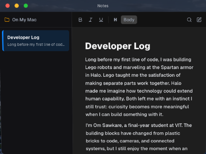
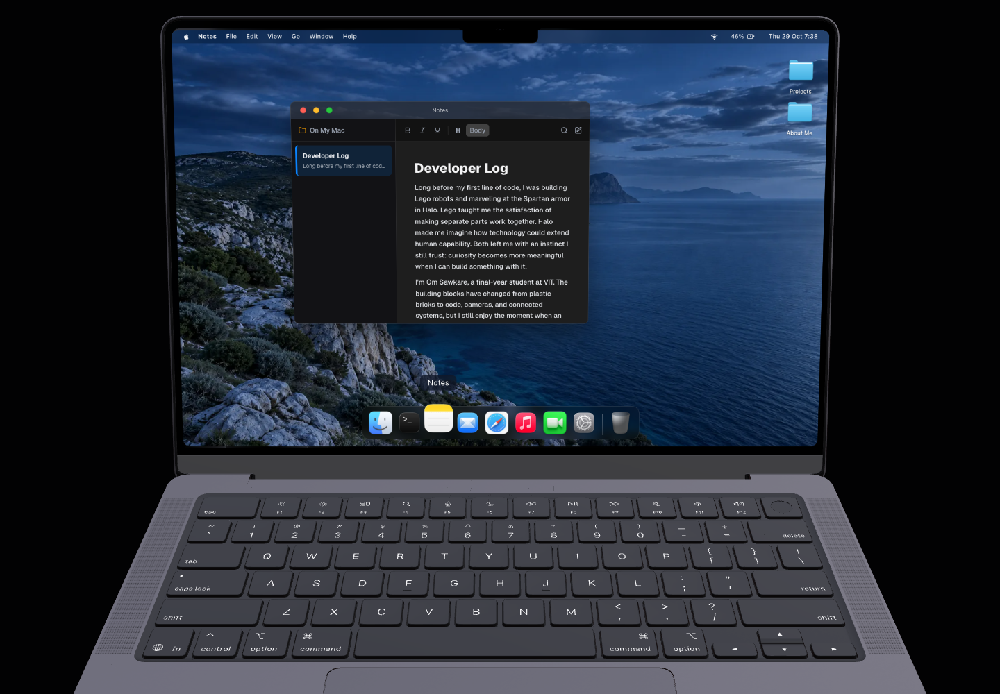

# Window control verification

The baseline Notes screenshot in [the Notes review](../notes-review/before-notes-desktop.png) uses the real projected laptop desktop at a 1440 × 1000 browser viewport. The old close, minimize, and maximize buttons were 13 × 13 local pixels; projection reduced each clickable area to approximately 8.5 × 8.5 screen pixels.

The revised controls keep their 13-pixel colored dots and increase the enclosing button to 28 × 28 local pixels. The test suite deliberately clicks the enclosing area outside each visible dot, exercises repeated real pointer maximize/restore/minimize actions, and stresses same-frame combinations of the handlers. It also checks keyboard activation, visible focus, reduced motion, drag cleanup on blur/cancel, and maximized bounds after browser resizing.

All five [final browser scenarios](after-browser-results.json) passed against the rebuilt production preview.

- All three padded hit targets respond to real pointer clicks outside the visible dots. They measure 28 × 28 local pixels, or approximately 18.3 × 18.3 screen pixels in this projection, compared with the original 8.5 × 8.5 screen pixels.
- Five real pointer cycles of maximize → restore → minimize → Dock reopen remain usable. A separate seven-action synchronous handler burst including repeated close requests finishes, and the app reopens without duplicate windows.
- Space/Enter keyboard activation, visible keyboard focus, and reduced motion pass.
- Dragging stops on blur and pointer cancellation. Closing/reopening while a real title-bar pointer is held does not let old listeners move the replacement window when that pointer later moves or releases.
- Maximized content remains inside the projected desktop at browser viewports of 1000 × 750, 1700 × 1100, and 1440 × 1000. Restore and Close still respond after resizing.

## Harness corrections and retained evidence

The [initial](initial-harness-results.json) and [intermediate](intermediate-harness-results.json) attempts are retained. One simultaneous-WebGL entry exceeded the harness deadline. The first Enter simulation omitted the native carriage-return text; adding it made the keyboard scenario pass.

The [Restore coordinate trace](restore-coordinate-trace.json) established that an attempted Restore click actually hit a sidebar DIV. The headless browser had paused the window spring between frames: its button appeared momentarily stable, but the frame still had `translateY(10.67px) scale(.9644)`. When rendering resumed between the coordinate read and pointer dispatch, the target moved. Normal coordinate actions now wait for the window transform to finish. The separate same-frame handler burst still tests state races without that coordinate wait. The test does not claim every attempted click on a moving target was delivered to a button. Failed captures remain alongside the final captures. The browser checks use isolated Chrome and do not claim physical Mac trackpad, Safari, or Windows device testing. A synchronous handler burst is explicitly marked in the results; it complements the real pointer sequences rather than representing trusted physical input.

The existing [Music lifecycle regression](../music-review/stage6-music-lifecycle.json) also passed: pause/resume, continued playback while minimized, immediate stop on Close, source cleanup, and reopening paused with a single player.
